# creative-skills

[Claude Code](https://claude.com/claude-code) skills I've made. Each one lives in `skills/<name>/` and is self-contained: a `SKILL.md` plus templates, examples and references.

| skill | what it does |
|---|---|
| [riso-rooms](skills/riso-rooms) | Isometric illustrations that look risograph-printed: cutaway rooms with halftone inks, misaligned plates and wobbly lines, drawn in code on a canvas you can pan and zoom. |
| [logo-intro](skills/logo-intro) | A kinetic name/logo intro in plain JS: atom rings, hyperspace warp, flash, letters popping in with doodles, a boiling highlight box, a wipe to a sparkle. |
| [hand-drawn-canvas-animation](skills/hand-drawn-canvas-animation) | Hand-drawn short films drawn in Canvas 2D JavaScript: whole-pose character drawings, ink, pencil, riso, screen print or brush-pen doodles on photos, plus rotoscoped real motion, sand animation and a pop-up paper book, rendered to mp4 with a generated Web Audio score. |
| [ink-abstraction](skills/ink-abstraction) | A 12-panel pen-and-ink abstraction sheet of any subject in vanilla JS: hatched sketch → black masses → cross-stitch grid → patterned cells → a few lines and one knot. |
| [morph-tile-loop](skills/morph-tile-loop) | Seamless geometric loops in vanilla JS: a dot opens into layered rings, morphs into a gradient star, zooms out over an endless lattice into halftone, and dives back in. |
| [iso-sim-town](skills/iso-sim-town) | A playable late-90s isometric sim town in vanilla JS: pre-rendered-looking buildings, baked shadows, dithered 256-colour pixels, traffic, day/night, a Props window and a Windows 98 UI. |
| [dither-diorama](skills/dither-diorama) | A live isometric cutaway of any place (restaurant, laundromat, office) in three.js through a square-dot dither shader, with a walking crowd, staff, scroll steps that highlight one group at a time, and a pull-back into a city. |
| [morning-debrief](skills/morning-debrief) | A daily brief page for a project: one self-contained HTML file with a public-domain painting header, the one thing to push forward, to-dos with sources, what's waiting on other people and what changed — built from Slack, meeting notes, calendar, git and local checklists, and installable as a scheduled run. |
| [slide-craft](skills/slide-craft) | Presentations as one self-contained HTML deck: fixed 1280×720 slides, thumbnail rail, presenter mode with notes, print to PDF — plus the thinking first (audience, the one sentence, the ask) and a list of the things that make slides look generated. |
| [pixel-showcase](skills/pixel-showcase) | A gacha-style "who's that?" reveal for pixel sprites: hold to charge a silhouette through rarity colours, then it bursts into its own pixels and reassembles in colour, with a stat card, NEW/SHINY stamps, a dex and chip-tune sound. Templates for animated Gen 1 Pokémon (live from PokeAPI) and procedurally generated creatures. |
| [sketchbook-portfolio](skills/sketchbook-portfolio) | An illustrated personal portfolio in plain HTML/CSS/JS: a red sketchbook hero with boiling hand-drawn SVG, stamp borders and chalk doodles, Lenis smooth scroll, a 3D-hinged page, notes that pin mid-screen while polaroids parallax past, project cards that land on a tilting grid board, nav hover doodles and click ink bursts. |
| [xray-scroll](skills/xray-scroll) | A scroll-driven x-ray film from any 3D model: three.js renders it see-through with dark rims and a floor reflection, it assembles part by part as GSAP ScrollTrigger scrubs one timeline over Lenis smooth scroll, and it cuts through pixel-mosaic, green dot-grid, red scanline, NO SIGNAL and datamosh glitches, with green tracking boxes, decoding captions and a timecode HUD. Single merged meshes (AI sculpts, scans) are split into parts automatically. |
| [comic-cover](skills/comic-cover) | Any 3D model (Meshy/AI sculpts, OBJ, FBX, glTF, rigged characters) as an interactive comic-book cover in three.js: ink outlines, cel shading, Ben-Day halftone and hatching, a Pencils → Inks → Colors switch, a masthead the hero breaks through, city / storm-sky / action-burst backdrops, drag-to-orbit, web and beam powers, lightning, SFX lettering and a duotone sense mode. |
| [scientific-figure-making](skills/scientific-figure-making) | Publication-ready matplotlib figures for papers, slides and reports: grouped bars, trends, heatmaps and multi-panel layouts in one house style (palette, fonts, spines, legend panels, print-safe hatching, vector export). By Chen Liu, from [figures4papers](https://github.com/ChenLiu-1996/figures4papers). |
| [dither-reveal](skills/dither-reveal) | Any image as a 1-bit Floyd–Steinberg dither that the cursor peels back to colour, in one WebGL2 page. Veil mode burns a lingering hole with colour leaking into the dots at its edge; filings mode turns every dot into an iron filing that the cursor lifts like a magnet into a spiky ferrofluid blob, then lets slide home. Comes with a script that cuts any photo off its background and embeds it, and a raymarched geode whose hover lens shows its cross-section. |
| [pixel-rebuild](skills/pixel-rebuild) | Any pixel-art video, GIF or screen recording rebuilt as a crisp canvas page, pixel for pixel: it finds the art's native grid (even non-integer upscales), splits the clip into one background, deduplicated sprites and a palette, and replays the timeline in a zero-dependency player. A Chrome check compares every frame with the source and exports a GIF. |
| [postage-collage](skills/postage-collage) | Original postage-stamp series as a collage page in plain HTML/CSS: ten stamp families (old-master editorial, pixel-fragment portrait, botanical strips, giant condensed word, narrow window, Swiss-Japanese pair, street-label ticket, green duotone panels, red duotone poster, red-circle collage), real CSS perforations, grain, postmarks and tape, a click-to-inspect zoom, and public-domain image fetch and print treatment from Wikimedia Commons. |
| [motion-reel](skills/motion-reel) | Short vertical motion graphics (Reels/Shorts, 1080×1920, ~20 s, with sound) rendered entirely in code with Python + skia + ffmpeg. Two templates: a flat editorial-poster explainer with a procedural beat-grid soundtrack, and a 3D-camera piece (dive, depth of field, an orbit that exposes an animate-to-camera cheat, 24 fps on twos, motion blur, cursor auto-zoom) cut to a stock track's real drops. Comes with lessons and a style catalogue from studying 30 motion-design reels, and scripts to study reference reels and to pick music and find its drops. |
| [signal-print](skills/signal-print) | A grainy signal-orange "ops-print" identity in two sheets of 4:5 plates: rotated tape strips with tickers, a crosshair emblem, a numbered run log, barred type crossed by a ring-matrix word, a live terminal, a halftone mark with a cursor loupe, a night-shift dial and an ID badge — plus an all-SVG asset kit (icons on keylines, mark construction and lockups, a blueprint, pattern tiles, seals and rubber stamps, an animated weave diagram, dingbats, live instruments) where every asset downloads as a clean .svg. |
| [isometric-svg](skills/isometric-svg) | Animated isometric line art in plain SVG + JS: black faces, hairline white strokes, glare bands, one accent. A tiny engine for boxes, extruded profiles, wheels, tubes, rounded plates and clipping through openings, all driven by a freezable clock. Examples: a draggable filing cabinet and a seven-panel F1 pit wall (pit stop with jacks and tyre change, scanner bay, live circuit map, telemetry, wind tunnel, tyres, timing tower) on one race clock, plus a contact-sheet script. |
| [motion-replica](skills/motion-replica) | Any motion-graphics video (app ad, promo, grid reel, UI walkthrough) rebuilt shot for shot in code: a deterministic HTML page with DOM for UI and type and three.js layers for 3D props, rendered frame by frame to an MP4 that matches the original's size, fps, length and audio. Scripts measure the reference (per-cell loop periods, cuts, contact sheets, 20 fps bursts for easing), compare replica and reference side by side and on motion sheets, and render on the GPU. Includes a procedural 3D kit (foil pouch, $100 bills, basketball, watch, embossed/glass/cel-shaded coins, bevelled 3D digits, a GLB repaint loader) and a full 2×2 fintech-ad example. |
| [spider-verse-look](skills/spider-verse-look) | Scenes and characters painted in the visual language of *Into the Spider-Verse*, as 2D drawings in Canvas + a small WebGL print pass: Ben-Day dots instead of gradients, misregistered plates instead of blur, characters on twos, ink that doesn't register. A reference built from reading every page of the film's art book and a making-of video (style bible, per-character and per-location rules with sampled hex, FX, 90 code recipes), a no-dependency painting kit, and a finished example of Miles swinging through a dusk Midtown canyon. |
| [sketch-storyboarding](skills/sketch-storyboarding) | Trailers, gameplay clips, scripts and scene ideas as rough graphite storyboard sheets with shot sizes, camera moves, motion arrows and production notes. A script cuts a clip into numbered shots on contact sheets, the plan lives in one board.json that prints as a blank lettered sheet for approval, an image model draws the panels from a bundled style reference, and a second script letters and assembles the sheet so every caption is exact. Also before/after camera-fix boards and animatic timing boards. |
| [hairline-create](skills/hairline-create) | One isometric line figure that answers the pointer, in the style and on the engine of [@lucasmarkes/hairline](https://github.com/lucasmarkes/hairline): rounded solids in a single stroke, springs instead of timers, a slider that drives one number. You pick a concept, it writes one figure file against a fixed kernel, then builds, validates and screenshots it into a single self-contained HTML page. By Lucas Marques. |
| [fframes-fx](skills/fframes-fx) | Videos rendered in code with [fframes](https://github.com/dmtrKovalenko/fframes) (Rust, SVG scenes, Skia GPU, ffmpeg) plus 44 GPU shader effects ported to SkSL from [shader-effects-inc/shaders](https://github.com/shader-effects-inc/shaders): aurora, mesh gradients, god rays, lens flare, film grain, light leaks, halftone, dither, VHS, CRT, glitch, a thermal heatmap, wipes and dissolves. A loader that applies each effect's documented defaults, a gallery that renders every effect next to its upstream cover, a porting guide for the rest, and the lessons from making a 21 s film with it. |
| [frosted-figure](skills/frosted-figure) | Any photo of a person as a figure behind frosted glass: a soft, grainy gradient-mapped silhouette on off-white, pale at the rim and deep in the core, rendered in plain JS on a canvas to PNG. The person is cut out in the browser with MediaPipe (any background), or colour-keyed off a plain backdrop. Green, gold, yellow, pink and blue palettes, plus a matching ladder built in OKLab from any hex colour. |
| [motion-prompts](skills/motion-prompts) | The real prompts behind 231 motion videos made with Claude Opus 5.5, scraped from [prompt-motion.com](https://prompt-motion.com/) and sorted into 11 categories: showreels, product promos and launch films, product explainers, concept explainers, short films, scenes and 3D, music, UI and logo motion, portfolio reels, games, and follow-up edits. Identical prompts are merged, fill-in brief templates are pulled to the top, and every entry credits the creator and links the post, the video and the gallery page. Also lists the four skills shared on the site. The prompts belong to their creators, who are credited on every entry. `uv run scripts/update.py --fetch` re-scrapes the site to refresh the library. |
| [typographic-sticker-ui](skills/typographic-sticker-ui) | Experimental editorial UI where a readable paragraph is the layout: oversized mixed typography with stickers, cutouts, arrows, highlights and small working widgets (progress, music, weather, calendar, toggles) set inline in the sentence, on a restrained base with two to four accents. Covers sticker treatment, asymmetric layout, interactions you discover inside the poster, motion and a quality checklist. For portfolios, personal sites, landing pages and expressive dashboards. |
| [app-designer](skills/app-designer) | iPhone app design that doesn't read as AI-made: concept interview, three directions on the core screen, iOS 26 rules, screens rendered with Apple's fonts in Chrome, scanned for AI tells and scored by a critic, plus SwiftUI and App Store panels. By [Tobia Donadon](https://www.tobiadonadon.com). |
| [web-designer](skills/web-designer) | Websites, web apps and components that read as studio work: directions, type, colour, motion craft, a slop scan, critique, and cross-platform render checks with metric-compatible stand-in fonts. By [Tobia Donadon](https://www.tobiadonadon.com). |
| [kawaii-pink](skills/kawaii-pink) | Cute hand-drawn logo stings rendered in code with fframes: one hot-pink boiling line on pale grey, puffy bubble-graffiti letters for any word (A-Z) that inflate one by one, smears that snap into stars, a faint 3x echo of the frame behind it, and an original mochi mascot that sits on the word, slurps the whole logo and hops to the centre with squash and stretch. Synthesized SFX on the same timeline, plus scripts to download and measure a reference clip and rebuild it. |
| [anatomy](skills/anatomy) | A technical idea explained as a real, working machine: crafted interactive isometric SVG figures (a dial gauge, a test rig, a desk computer, an arcade cabinet, a rocket engine in a test stand) with many small precise parts, four-tone shading, correct painter's order, a framed card with title and live readout, and calm eased motion. A zero-dependency kit (lathe, tubes, depth sort, an audit that proves nothing intersects), WebGL shaders that live in the same isometric camera (exhaust, water, caustics, lamp light) and an optional true-3D mode. Framework-free or React/Next.js. By [Ryan](https://github.com/wheresryan22/anatomy). |
| [launch-promo](skills/launch-promo) | Kinetic product-launch films rendered in code: paper-and-ink sticker cards with hard shadows, one acid accent and a brand field colour, heavy Inter headlines rising word by word on the voiceover, a mascot that carries the cuts, tilted 3D phones, dark feature cards that light up one by one, ring/circle/panel wipes, stamps, counters, toggles and a CTA click. One pure `seek(t)` HTML page rendered by parallel headless Chromium with motion blur, an ElevenLabs voiceover laid line by line on target beats, an ElevenLabs Music score cut to the scenes, and synthesised SFX. A 20 s template for any product, a full 57.5 s worked example, scripts to study a reference, and references for the aesthetic, motion, text, structure and audio. |
| [3d-deep-explainer](skills/3d-deep-explainer) | A cinematic, interactive 3D "machine" in three.js that explains how something works: data flows along a workbench through 6–10 stations (glass lenses for matrices, drawer cabinets for lookup tables, beams sized by weight, gauges, histograms, an exploded view for depth), with eased fly-throughs, what-if toggles that re-run the computation, a guided Tour and a frame-stepped tour video. A tiny real implementation runs live, so every number on screen is genuine. Comes with a generic engine and 3-station starter, a 13-part station cookbook, a train-a-tiny-real-model pipeline, screenshot and recording scripts, and the full Next-Word Machine (a real 2-layer Transformer with a MoE twin) as the worked example. |
| [doc-shorts](skills/doc-shorts) | Vertical documentary and infographic shorts rendered in code with fframes, in a retro "archive under glass" look: scanlines, a 30° halftone screen and low grain over real archival photos, small Instrument Serif captions with a chromatic fringe, flat grey, paper and black type cards, and graphic beats (a network Earth, a wireframe globe grid, a thumbnail tunnel, a magnifier, a typed search pill, charts). Everything animates on threes and cuts on narration words. One `video.toml` per film: an ElevenLabs voiceover with word timings, an optional ElevenLabs Music bed, and one shot per cut cued on a word. 15 shot kinds, tools for voice, music, Whisper timings, cut-outs and side-by-side review, a script that studies a reference reel tick by tick, and a 27 s reel about Google's origin at Stanford rebuilt tick for tick as the worked example. |
| [saas-promo](skills/saas-promo) | Snappy SaaS and product promo films rendered in code with fframes, in the "glass on a screen gradient" look of the bolt.new weekend promo: a deep gradient behind a monitor dot screen, words that blur in as frosted glass and settle, highlight boxes that pop, caption groups that tilt in and settle, a frosted pill that grows into an app window, a prompt typed with a cursor click, an editor whose site scrolls, a card wall with depth of field and a button click, and a logo end card. One `video.toml` sets the palette (presets or one brand colour), fonts, the flow (8 scene kinds in any order), durations in seconds or beats snapped to the music's beat grid, and the music. Tools for beat detection, an original synthesized bed, palettes, credited photo search and cut-outs, HTML-to-PNG screens and backdrop fitting; the bolt.new promo rebuilt shot for shot (with reference frames) and an original second film. |
| [colorfigures](skills/colorfigures) | Hand-inked, flat-coloured isometric figures of everyday machines (a gumball machine, a kettle, a record player, a washing machine) as one self-contained HTML page with buttons that really work: real 3D bodies shaded in light, mid and dark bands, a heavy ink silhouette with finer inner lines, a flat blue cast shadow, a hand-drawn wobble slider and body-colour swatches. Ask how something works and it labels the parts, lighting each one up while it works. By [April Zhu](https://april-zhu.com/colorfigures). |
| [rossark-motion-skill](skills/rossark-motion-skill) | Calm, believable motion for anything drawn: live faces (gliding pupils, blinks that close faster than they open, happy squints), full-body acting (floating with limp feet, landing with squash, waving, kicking a ball), plants, cloth, fire, smoke, water, weather, machines, icons, logos, charts and whole scenes. One clock per scene, parts that turn on their real pivots, follow-through by delay, idle life that never stops and `flow` curves through key poses. A small motion engine and live-face templates for SwiftUI and React Native, tools that measure a reference video frame by frame, and four demo scenes with an offline renderer to MP4 and GIF. By [Ross](https://github.com/rossark0). |
| [photoreal-spot](skills/photoreal-spot) | Photoreal product and sports spots cut to a soundtrack's hits, rendered in code with fframes: photoreal stills turned into AI video plates (Vizard or Wan), framed snap cuts (picture cards on a backdrop gradient, smears, black frames, thin white boxes that track the product with trailing boxes, found by Jev and cached), whips, lens kicks, flashes, a mono HUD, a tagline slam and a logo lockup. One `spot.json` per spot; tools study a reference's cuts and its track's onsets, unpack clips, build plates and snaps, render, and score the cut against the reference with Jev. An adidas x NBA spec spot is the worked example. |
| [dimensional-drawing](skills/dimensional-drawing) | Any UI component (or physical product) as a one-page Apple-style dimensional drawing: a title block with the key variables, then one dense monochrome sheet with notes, a plan view with chained dimensions and radius callouts, an exploded view of the layer stack, detail circles (nested corner, radii, body) and variable tables. It draws architecture, not content (`TITLE SLOT · FLEX`, `ACTION · HUG`), every dimension is a code with its formula (`H1 = 2·S1 + H3`, `R2 = R1 − B − S6`), nothing is branded and unknown values stay `[TBD]`. Measures the real component in Playwright; ships an SVG drawing kit and card and dialog sheets as examples. By [Enes Ozturk](https://github.com/enesozturk/dimensional-drawing). |
| [dimensional-drawing-motion](skills/dimensional-drawing-motion) | A finished dimensional drawing as a ~10 s film, like a pen drawing the sheet while a camera moves over the paper: the header draws in close up, the camera pulls back to the plan, layers lift off it into the exploded view (strokes first, fills after) and the full sheet resolves. The scene is a pure function of time, so it runs in Claude's Motion artifact or headless with Playwright + ffmpeg. By [Enes Ozturk](https://github.com/enesozturk/dimensional-drawing). |

## Install

Clone once, then link the skills you want:

```sh
git clone https://github.com/IshaanKalra2103/creative-skills ~/src/claude-skills
ln -s ~/src/claude-skills/skills/riso-rooms ~/.claude/skills/riso-rooms
ln -s ~/src/claude-skills/skills/logo-intro ~/.claude/skills/logo-intro
ln -s ~/src/claude-skills/skills/hand-drawn-canvas-animation ~/.claude/skills/hand-drawn-canvas-animation
ln -s ~/src/claude-skills/skills/ink-abstraction ~/.claude/skills/ink-abstraction
ln -s ~/src/claude-skills/skills/morph-tile-loop ~/.claude/skills/morph-tile-loop
ln -s ~/src/claude-skills/skills/iso-sim-town ~/.claude/skills/iso-sim-town
ln -s ~/src/claude-skills/skills/dither-diorama ~/.claude/skills/dither-diorama
ln -s ~/src/claude-skills/skills/pixel-showcase ~/.claude/skills/pixel-showcase
ln -s ~/src/claude-skills/skills/sketchbook-portfolio ~/.claude/skills/sketchbook-portfolio
ln -s ~/src/claude-skills/skills/scientific-figure-making ~/.claude/skills/scientific-figure-making
ln -s ~/src/claude-skills/skills/dither-reveal ~/.claude/skills/dither-reveal
ln -s ~/src/claude-skills/skills/xray-scroll ~/.claude/skills/xray-scroll
ln -s ~/src/claude-skills/skills/comic-cover ~/.claude/skills/comic-cover
ln -s ~/src/claude-skills/skills/pixel-rebuild ~/.claude/skills/pixel-rebuild
ln -s ~/src/claude-skills/skills/postage-collage ~/.claude/skills/postage-collage
ln -s ~/src/claude-skills/skills/motion-reel ~/.claude/skills/motion-reel
ln -s ~/src/claude-skills/skills/signal-print ~/.claude/skills/signal-print
ln -s ~/src/claude-skills/skills/isometric-svg ~/.claude/skills/isometric-svg
ln -s ~/src/claude-skills/skills/motion-replica ~/.claude/skills/motion-replica
ln -s ~/src/claude-skills/skills/spider-verse-look ~/.claude/skills/spider-verse-look
ln -s ~/src/claude-skills/skills/sketch-storyboarding ~/.claude/skills/sketch-storyboarding
ln -s ~/src/claude-skills/skills/hairline-create ~/.claude/skills/hairline-create
ln -s ~/src/claude-skills/skills/fframes-fx ~/.claude/skills/fframes-fx
ln -s ~/src/claude-skills/skills/frosted-figure ~/.claude/skills/frosted-figure
ln -s ~/src/claude-skills/skills/motion-prompts ~/.claude/skills/motion-prompts
ln -s ~/src/claude-skills/skills/typographic-sticker-ui ~/.claude/skills/typographic-sticker-ui
ln -s ~/src/claude-skills/skills/app-designer ~/.claude/skills/app-designer
ln -s ~/src/claude-skills/skills/web-designer ~/.claude/skills/web-designer
ln -s ~/src/claude-skills/skills/kawaii-pink ~/.claude/skills/kawaii-pink
ln -s ~/src/claude-skills/skills/anatomy ~/.claude/skills/anatomy
ln -s ~/src/claude-skills/skills/launch-promo ~/.claude/skills/launch-promo
ln -s ~/src/claude-skills/skills/3d-deep-explainer ~/.claude/skills/3d-deep-explainer
ln -s ~/src/claude-skills/skills/doc-shorts ~/.claude/skills/doc-shorts
ln -s ~/src/claude-skills/skills/saas-promo ~/.claude/skills/saas-promo
ln -s ~/src/claude-skills/skills/colorfigures ~/.claude/skills/colorfigures
ln -s ~/src/claude-skills/skills/rossark-motion-skill ~/.claude/skills/rossark-motion-skill
ln -s ~/src/claude-skills/skills/photoreal-spot ~/.claude/skills/photoreal-spot
ln -s ~/src/claude-skills/skills/dimensional-drawing ~/.claude/skills/dimensional-drawing
ln -s ~/src/claude-skills/skills/dimensional-drawing-motion ~/.claude/skills/dimensional-drawing-motion
```

Then ask Claude Code for one (e.g. "make an animated intro for my name") or run `/logo-intro`, `/riso-rooms`.

---

## riso-rooms

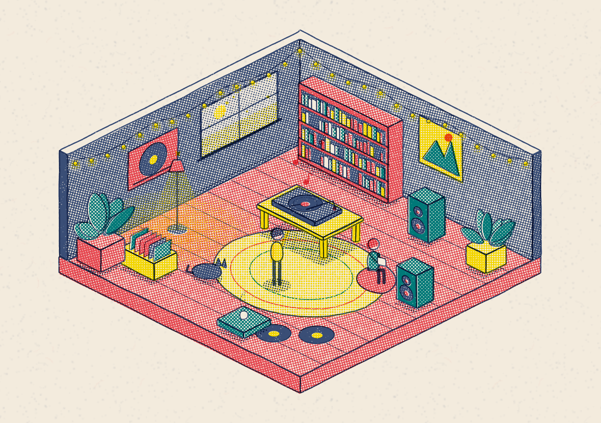

*`examples/listening-room.html`: records spinning, string lights twinkling, a dancer, a cat. Every mark is drawn in code.*

- `SKILL.md`: the rules for the look, the workflow (plan rooms → block out → screenshot → add clutter → animate), and guidance on scale, density and tone.
- `template/index.html`: a zero-dependency engine plus two example rooms.
- `examples/listening-room.html`: a full single-room scene (the image above).
- `references/api.md`: the drawing API (boxes, walls, windows, bookcases, lamps, plants, people in 6 poses, light, steam…).

**Controls:** drag or scroll to pan and zoom, pinch on touch, WASD to move, `0` to fit, `P` to save a PNG, double-click a room to fly to it.
**URL options:** `?room=<id>`, `&zoom=N`, `?frame=N` (freeze time), `?still` (no idle tour).

Inspired by Kevin Ngo's ["a small light, room by room"](https://a-small-light-three.vercel.app/) ([tweet](https://x.com/kevin_t_ngo/status/2100238648218427563)). The engine and scenes here are original code.

## logo-intro

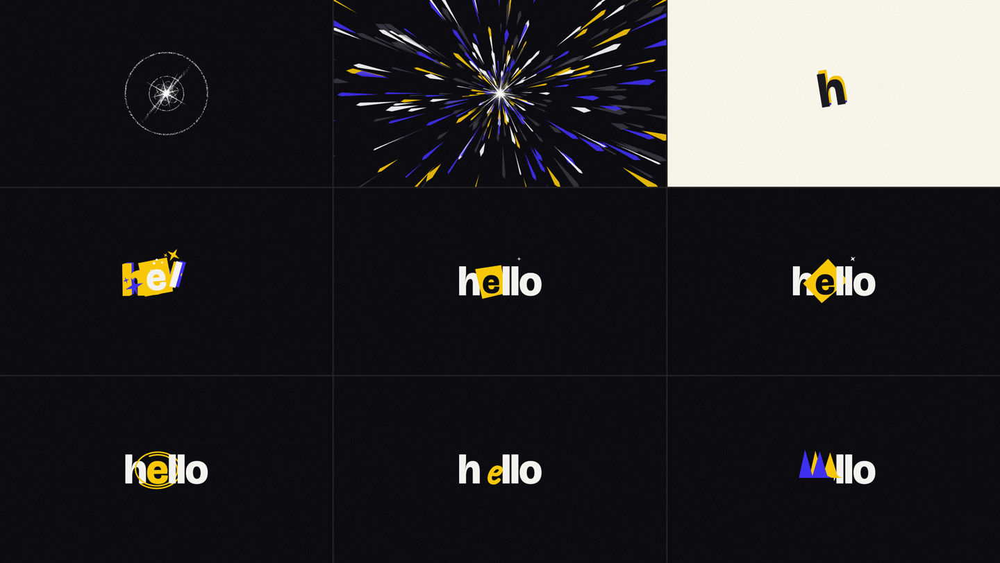

- `SKILL.md`: the stage timeline, how to retime or cut stages, the rules of the look, and how to check it with frozen-frame screenshots.
- `template/index.html`: the whole animation (~350 lines of canvas JS, no libraries).

**Controls:** click or space to replay.
**URL options:** `?name=ada`, `&accent=0` (which letter gets the box), `&yellow=ff5a36&blue=00a37a` (any palette key, hex without `#`), `&speed=0.8`, `?t=9` (freeze time).

Made by rebuilding a reference motion-graphics intro frame by frame in JavaScript.

## hand-drawn-canvas-animation

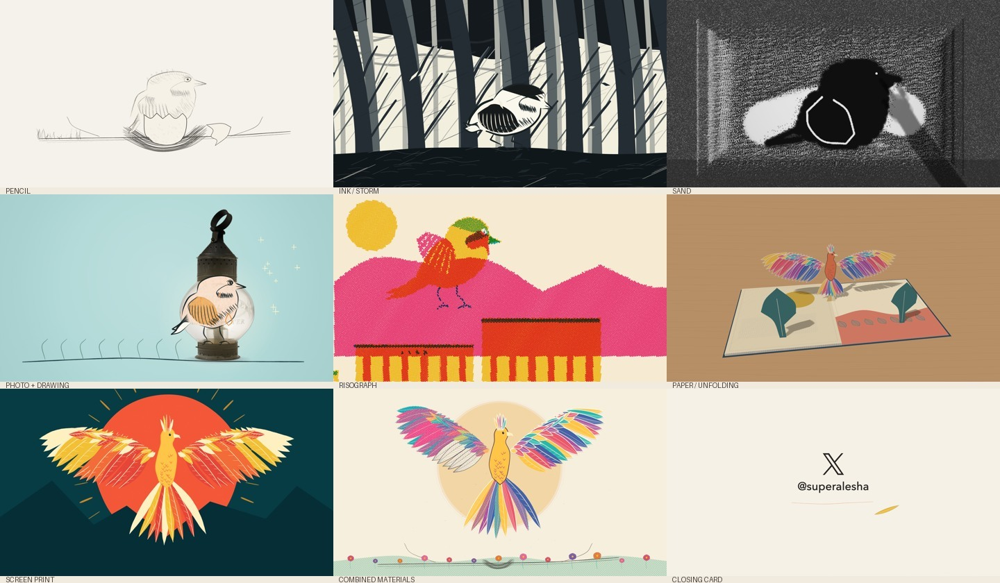

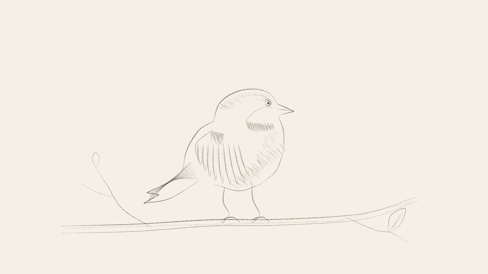

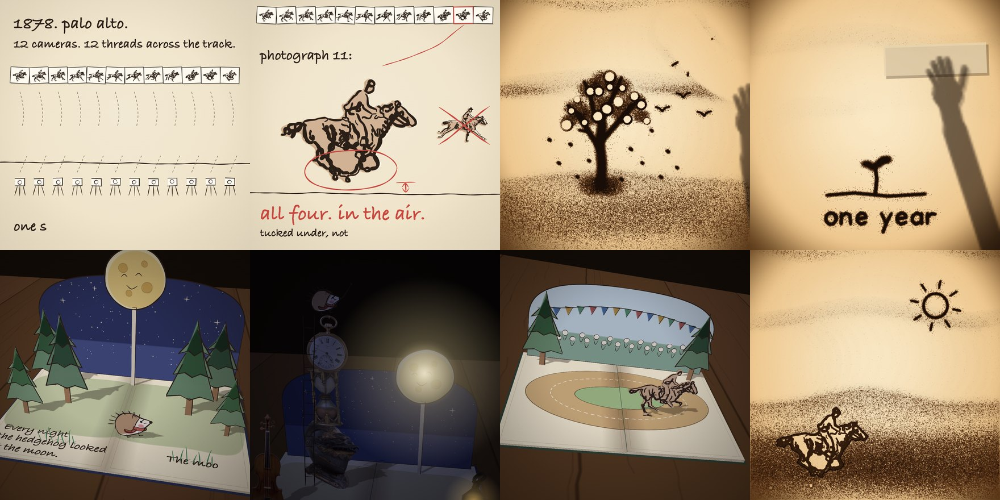

- `SKILL.md`: the procedure (brief → beat sheet → palette → key poses → scenes one at a time → full render → score), the rules and a review checklist.
- `assets/core.js` + `assets/film-template.html`: the shared core (palettes, finishes, marks, reveals, photos and doodles, camera, timeline, player) and the file you copy per film. Engines that load beside it: `roto.js` (found motion traced from video), `sand.js` (a sand bed on backlit glass), `paper3d.js` (pop-up pages in a 3D room), plus `cels.js`, `materials.js` and `studio.js`.
- `examples/`: `becoming-phoenix/`, a 60 s film that moves through five drawing styles, sand and a pop-up book; `sketchbook-bird.html`, a whole-pose pencil study; the fruit fly, four looks, museum-photo doodles and night chase; gallop, paper horse, moon book, one seed, one year, weight and material studies; and `workshop.html`, a point-and-click screen that drives the film engine.
- `scripts/`: `render.mjs` (frame grid, spot frames, mp4 on twos with the score, contact sheet), `verify.mjs`, `photo.mjs` (cut a photo out of its background) and `roto.py` (trace motion from a video).
- `references/`: style rules, palettes, redrawn animation, motion, mixed media, found motion, sand, paper3d, studio, the doodle look, architecture and pitfalls.

Needs Node 18+, Chrome and ffmpeg; the doodle look cuts photos best with `rembg` on PATH. `cd` into a film folder with `core.js`, `render.mjs` and `package.json`, `npm i`, then `node render.mjs film.html --grid 24`.

Synced from [alesha-pro/tools](https://github.com/alesha-pro/tools/tree/main/skills/hand-drawn-canvas-animation) (MIT, see the skill's `LICENSE`). The first looks are rebuilt from Kevin Ngo's films ([the life of a fruit fly](https://x.com/kevin_t_ngo/status/2099858454043349342), [doodles on photos](https://x.com/kevin_t_ngo/status/2100601972902842517) and others).

## ink-abstraction

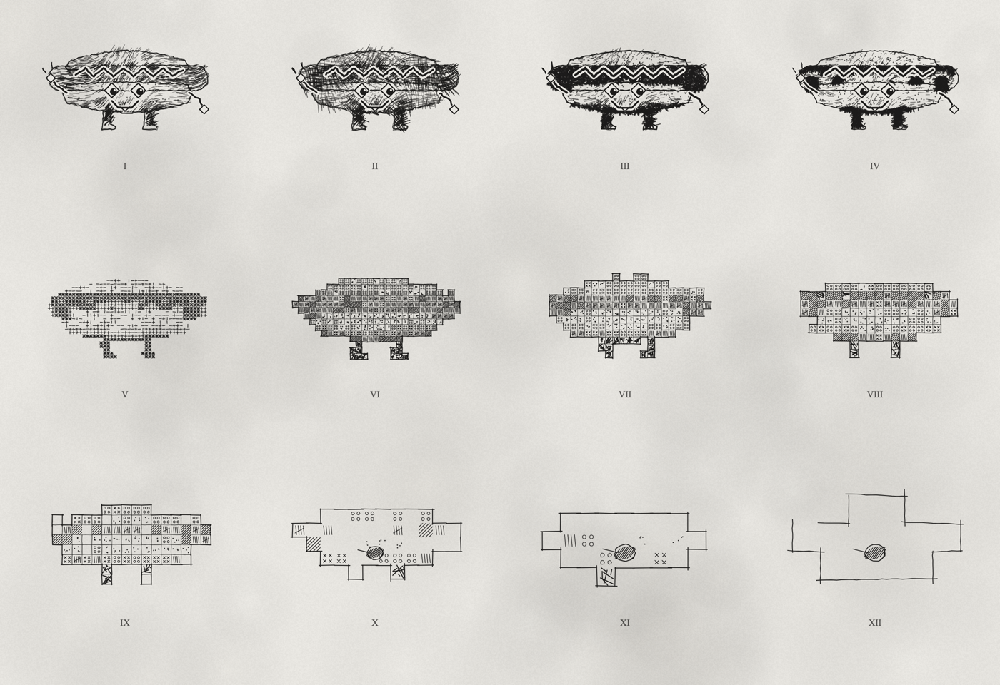

- `SKILL.md`: how to describe a subject (silhouette polygons, a shade field, detail strokes, an anchor), the rules of the look, and how to check it with a headless screenshot.
- `assets/engine.js`: the twelve stages, paper, boil and controls, no libraries. A subject file calls `defineSheet({...})`.
- `examples/`: a grazing bull and a cartoon hot dog. `scripts/shot.sh`: screenshot a sheet with headless Chrome.

**Controls:** click for a new variation, `B` toggles the boil. **URL options:** `?still`, `?seed=N`.

## morph-tile-loop

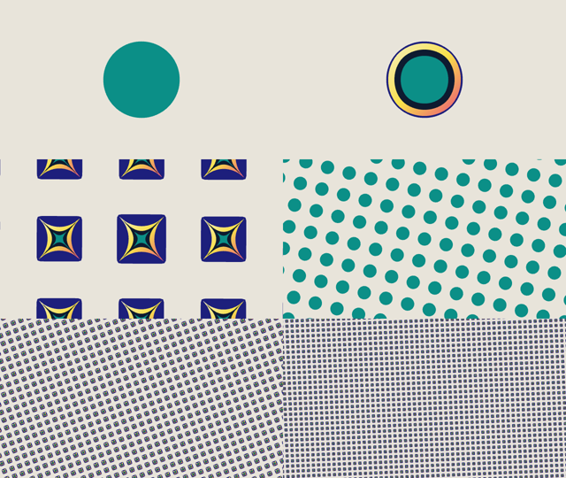

- `SKILL.md`: how the loop works (layered superellipses, keyframed channels, log zoom, symmetric spin), the workflow for matching a reference video, and the rules of the look.
- `assets/engine.js`: timeline, zoom, square/hex lattice, shape drawing and controls, no libraries. A loop file calls `defineLoop({...})`.
- `template/index.html`: teal circle → gradient star in a navy square → halftone → back, 8 s.
- `examples/hex-bloom.html`: a riso palette on a hex lattice with six-point shapes (`assets/hex-bloom.png`).
- `scripts/shot.sh`: a contact sheet of frozen frames, or `--mp4` for a full render with headless Chrome + ffmpeg.

**Controls:** space pauses. **URL options:** `?t=3.2` (freeze time), `?speed=0.5`.

Made by rebuilding a reference motion loop frame by frame in JavaScript.

## iso-sim-town

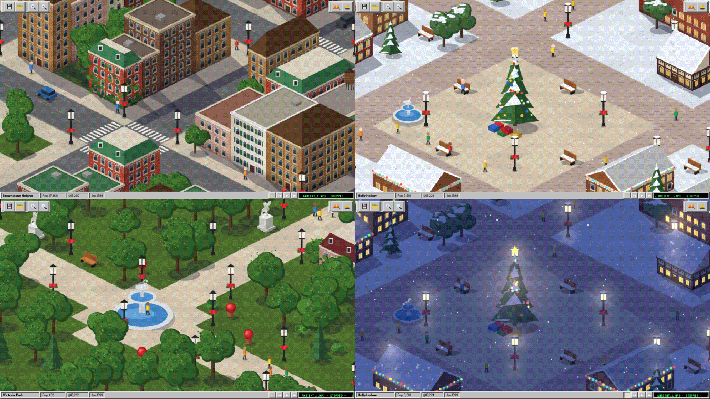

- `SKILL.md`: the five-stage pipeline behind the pre-rendered look (native 64×32 iso, baked lighting, grain textures, low-res nearest-neighbour upscale, ordered-dither palette), the workflow for laying out a town, and the rules of the look.
- `assets/engine.js`: renderer, building painter, props, traffic, pedestrians, Props window, bulldozer, day/night, save, generated ambient music and the Win98 UI, no libraries. A town file calls `defineTowns([...])`.
- `template/index.html`: one brownstone city with taxis, pedestrians and parks.
- `examples/three-towns.html`: the city plus a snowy Christmas village and a Victorian park.
- `scripts/shot.sh`: a contact sheet of views with headless Chrome, printing console errors.

**Controls:** drag or WASD to pan, wheel or `+`/`-` to zoom, hard-hat opens Props (click to place), bulldozer removes, moon toggles night, `P` pixel size, `X` dither, `M` or `1`–`9` switch towns.
**URL options:** `#2` (open town 2), `#2n` (at night).

Made by rebuilding a reference video of an isometric town builder in JavaScript.

## dither-diorama

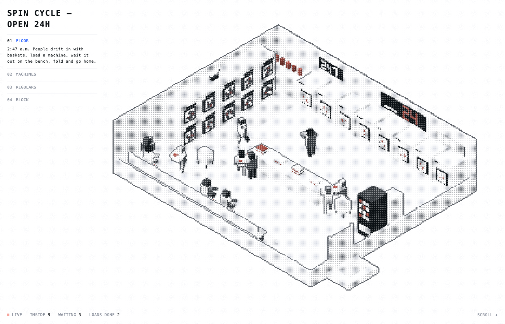

- `SKILL.md`: the five parts of the look: boxes in greys with one accent, the cell render, the soft pen, wash-not-zoom highlights and the city pull-back. Also the workflow from planning the flows to checking the stills, and the traps.
- `assets/engine.js`: `createDiorama(config)`. It covers the room shell, the build kit (grouped boxes, obstacles, seats, digits, ticks), grid A* pathfinding, and the visitor route (queue, counter with courier fetch, seat, visit). It also covers staff (post, patrol, courier), the three-pass dither render, the step UI and the generated city with traffic.
- `references/config.md`: the full config contract.
- `template/index.html`: a counter-service restaurant (Floor, Staff, Stock, City). Preview: `assets/restaurant-steps.png`.
- `examples/laundromat.html`: "Spin Cycle". Washers spin up when loaded, people read on the bench and fold, an attendant mops, a cat walks the dryers and the neon glows coral.
- `examples/pit-stop.html`: "Box, box", a Formula 1 pit stop out in the open. The car brakes in, 17 crew swap all four tyres around a live stop clock, the lollipop flips and the car launches. Includes a quarter-speed replay step.
- `scripts/shot.py`: `uv run` it to shoot every step into a contact sheet, with crowd stats and page errors.

**Scroll** moves through the steps, and clicking a step title jumps to it. **URL options:** `?step=2` (pin a step), `?speed=4`, `?t=5.2` (freeze the clock).

Made by rebuilding the "How it works" section of meuze.ai from its live behaviour, then generalising it.

## License

MIT, except skills that ship their own `LICENSE`: hand-drawn-canvas-animation (MIT, Alexey Fateev), scientific-figure-making (CC BY-NC 4.0, Chen Liu), hairline-create (MIT, Lucas Marques), anatomy (MIT, Ryan), colorfigures (MIT, April Zhu; its demo figures and previews are hers too) rossark-motion-skill (MIT, Ross; its demo scenes and videos are theirs too) and dimensional-drawing and dimensional-drawing-motion (MIT, Enes Ozturk; their demo sheets and film are theirs too). The prompts in motion-prompts belong to their creators, who are credited on every entry. Only its script and categorisation are MIT. The reference images in typographic-sticker-ui are third-party artwork kept for personal reference. app-designer and web-designer are by Tobia Donadon and are not MIT. The morpho photo in dither-reveal's example is CC BY-SA 4.0 (Didier Descouens / MHNT).

## pixel-showcase

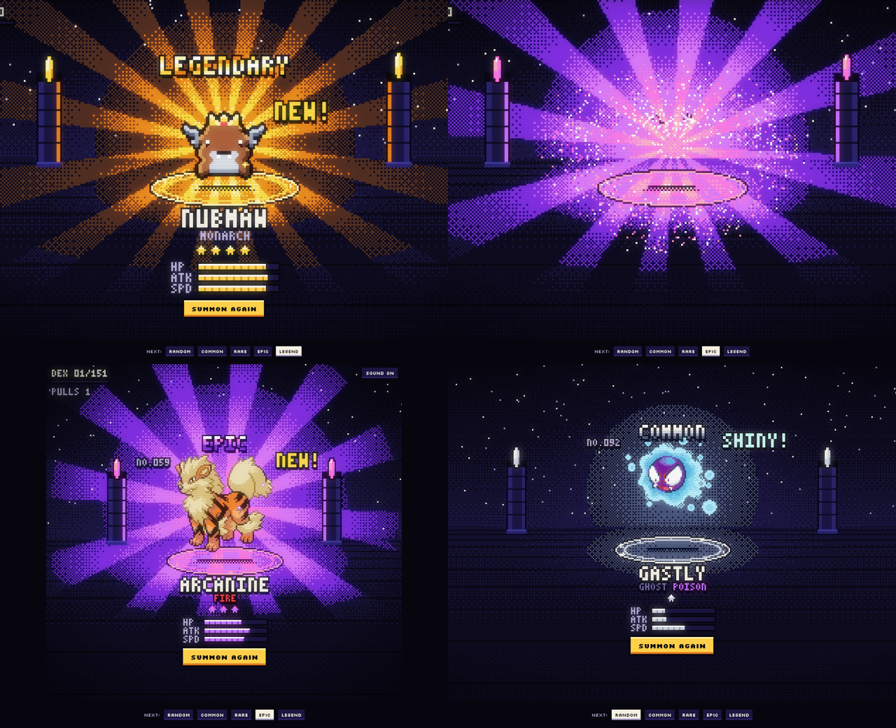

*Clockwise from top left: a generated legendary, the pixel burst on an epic pull, a shiny Gastly, Arcanine's card.*

- `SKILL.md`: the reveal phases, rarity rules, how to plug in your own game's sprites (GIFs or sheets), and how to verify it with screenshots.
- `template/pokemon.html`: 151 Gen 1 Pokémon with their animated Black/White sprites, shinies (1/16), types, stats and cries, fetched live from [PokeAPI](https://pokeapi.co). Nothing Pokémon is bundled in the repo.
- `template/creatures.html`: 30 seeded species (bodies, eyes, wings, horns, crowns by rarity) that blink and breathe. Works offline.

**Controls:** press and hold anywhere (or hold Space) to charge; tap the revealed sprite to poke it; the bottom pills force the next rarity; mute top right.

Inspired by my own pixel loot-card opener. Pokémon © Nintendo / Game Freak / The Pokémon Company; this is a fan toy.

## sketchbook-portfolio

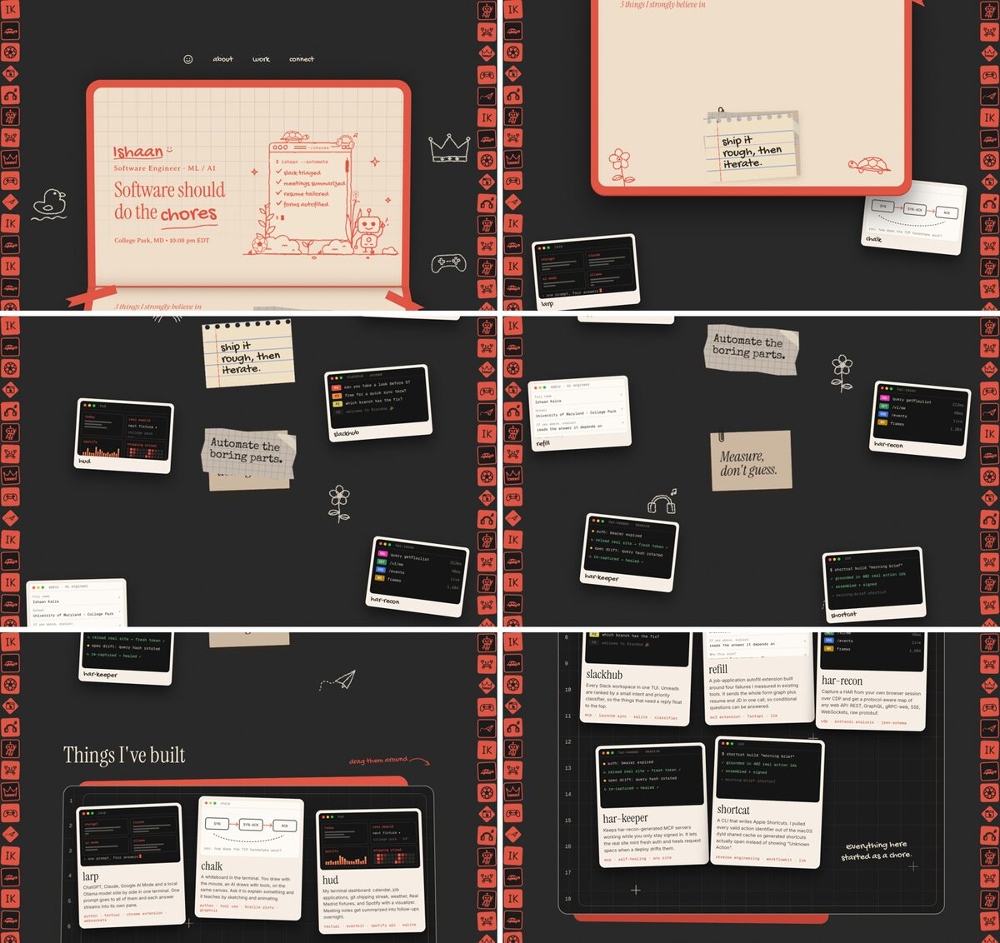

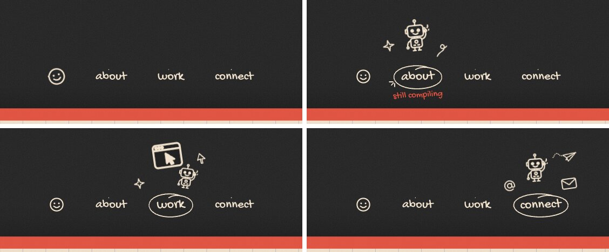

- `SKILL.md`: the sections and what moves in each, the workflow (collect real facts → fill the template → draw the person's own doodles → verify), how to draw doodles that boil, the scroll tuning knobs, and gotchas.
- `template/`: the placeholder site. `styles.css` + `main.js` are the engine (identical everywhere); `index.html` holds the content, the SVG doodle library and `window.SITE`.
- `examples/ishaan/`: my own site built from it.
- `scripts/shot.mjs`: screenshots at scroll positions, each nav hover, or phone size, tiled into a contact sheet, with console errors. Node 22+, Chrome and ffmpeg, no npm deps.

**Controls:** scroll; hover the nav and the stamps; drag the project cards once they land; tap the ball.
**URL options:** `?y=1800` opens a static frame at that scroll position (no smooth scroll), for screenshots.

Inspired by [Jackie Zhang's portfolio](https://jackiezhang.co.za/). The code and illustrations are original.

## xray-scroll

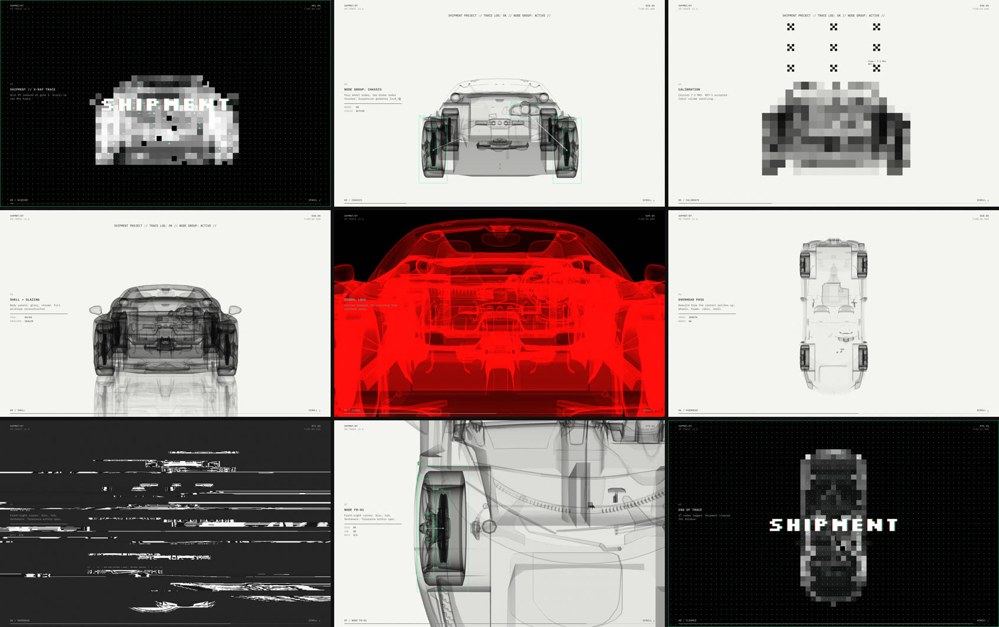

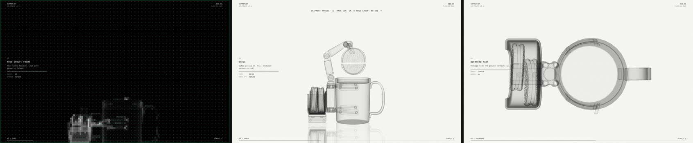

- `SKILL.md`: how the x-ray and the glitches are built, the workflow (scaffold → stage the build → contact sheet → captions), rules and limits.
- `template/`: `engine.js` (renderer, x-ray and glitch shaders, model normalising/splitting/staging, tracker HUD, Lenis + ScrollTrigger) and `styles.css` are shared; `film.js` (the storyboard, one 100-unit GSAP timeline) and `index.html` (`window.XRAY` config, captions) are per film.
- `examples/shipment/`: the reference film, an x-ray Ferrari that assembles wheel-first.
- `scripts/`: `new-film.sh` (scaffold), `glb-parts.mjs` (node names as three.js sees them), `shot.mjs` (GPU headless screenshots at timeline points, tiled into a contact sheet; no npm deps), `serve.mjs`, `sync-engine.sh`.
- `references/config.md`, `references/film.md`: every config field; state keys, effect recipes, the storyboard beat by beat, and the traps already hit.

**Controls:** scroll (scrolling fast tears the image).
**URL options:** `?p=NN` jumps to NN% of the film; `?parts` logs how the model was split and staged.

Inspired by a reference clip of an x-ray car ("SHIPMENT PROJECT // TRACE LOG"); the code is original. The Ferrari 458 Italia model is by [vicent091036](https://sketchfab.com/models/57bf6cc56931426e87494f554df1dab6), from the three.js examples. It's loaded from the three.js repo, not copied here. The coffee machine is `coffeemat.glb` from the three.js examples.

## comic-cover

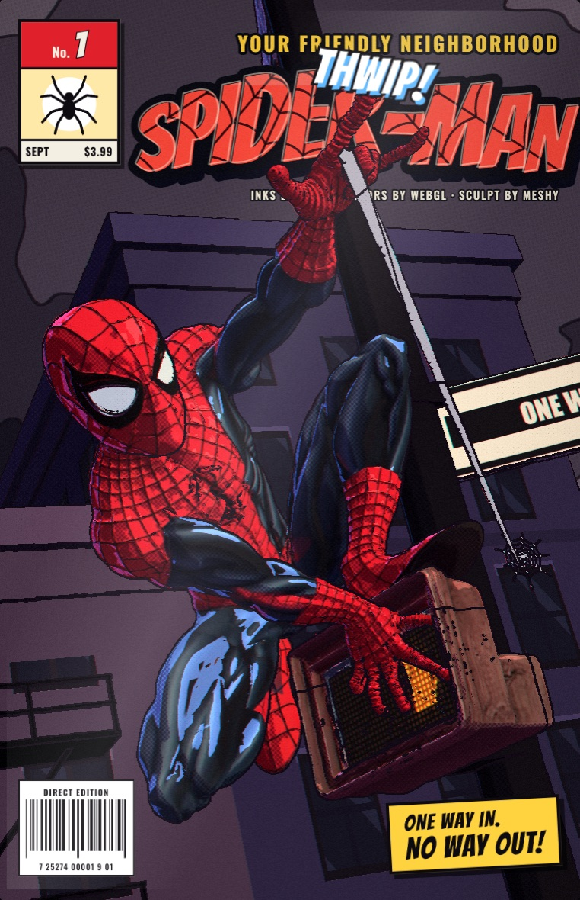

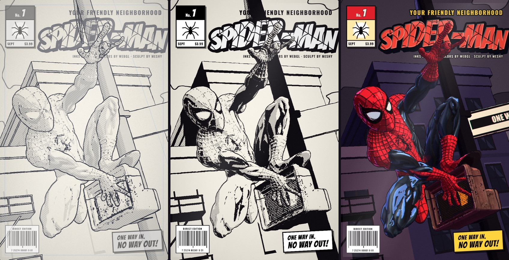

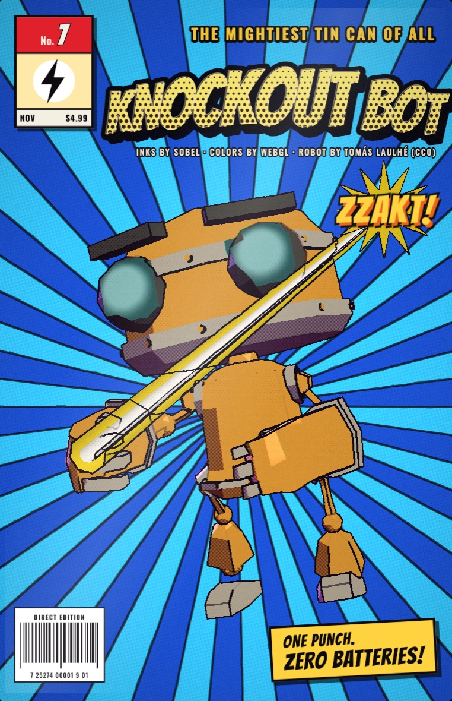

- `SKILL.md`: how the look is built, the workflow (scaffold → probe the model → config → frame → exercise every interaction), composition rules for covers, and the rules of the look.
- `engine/`: the shared renderer (one MRT pass → ink/halftone/hatching composite), sets, masthead, effects, synthesized sound, plus `probe.html`, a model inspector that puts five orthographic views on model-space grids and raycasts any pixel to an exact point.
- `template/index.html`: a cover is this page plus a `window.COVER` config.
- `examples/spider-man/`, `examples/robot/`: a Meshy sculpt with a web power, a walk-signal decal and a clickable prop; a rigged CC0 robot frozen mid-punch with a beam and glowing eyes.
- `scripts/`: `new-cover.sh` (scaffold), `build-model.sh` (OBJ/FBX/glTF/GLB → one small meshopt GLB), `shot.mjs` (GPU headless screenshots with JS between frames; no npm deps), `serve.mjs`, `sync-engine.sh`.
- `references/config.md`, `references/pipeline.md`: every config field; how the render works, how to extend it, and the traps already hit.

**Controls:** move the mouse to tilt the cover; drag to orbit (springs back); click a building, the sky, the hero or a prop; `1` `2` `3` switch Pencils / Inks / Colors; the sense key; `M` mutes.
**URL options:** `?az= &el= &roll= &dist= &fov=` camera, `?seed=N` city layout, `?stage=0|1|2`, `?still` (no drift, boil or ambient lightning).

The robot is [RobotExpressive](https://github.com/mrdoob/three.js/tree/dev/examples/models/gltf/RobotExpressive) by Tomás Laulhé (CC0), modified by Don McCurdy. The Spider-Man sculpt is fan art made with Meshy AI; Spider-Man is a trademark of Marvel.

## scientific-figure-making


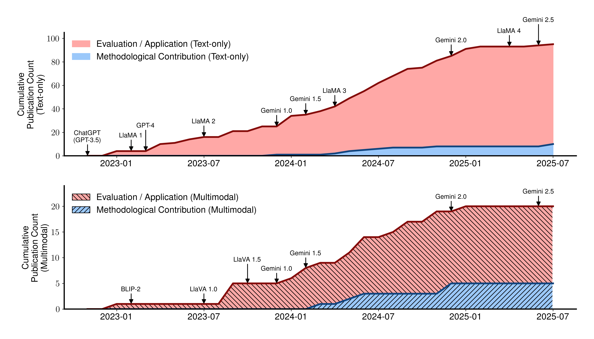

- `SKILL.md`: when to load it (matplotlib figures with a publication target) and when not to (Plotly/Altair/Bokeh, EDA-only plots, 3D/GIS, Figma-first infographics).
- `references/design-theory.md`: the house style measured from the real scripts: fonts and sizes, spines, the blue/green/red/neutral palette and what each colour means, export DPI, layout rules.
- `references/api.md`: `PALETTE`, `FigureStyle` and the helper signatures (`apply_publication_style`, `make_grouped_bar`, `make_trend`, `make_heatmap`, `finalize_figure`…) to implement per project.
- `references/common-patterns.md`: ultra-wide panels, a legend-only axis, hidden category ticks, tight y-limits, black edges and hatching so bars survive grayscale print.
- `references/tutorials.md`: grouped bars, multi-panel trends with a legend column, a labelled heatmap.
- `references/demos.md`: links to the upstream `figure_*` folders, the canonical scripts behind the style.

Copied unchanged from [ChenLiu-1996/figures4papers](https://github.com/ChenLiu-1996/figures4papers/tree/main/scientific-figure-making) (`3c181f8`) by [Chen Liu](https://chenliu-1996.github.io/). Licensed CC BY-NC 4.0, not MIT: see the skill's `LICENSE`. The preview images are upstream's `figure_ImmunoStruct` and `figure_ophthal_review` outputs.

## dither-reveal

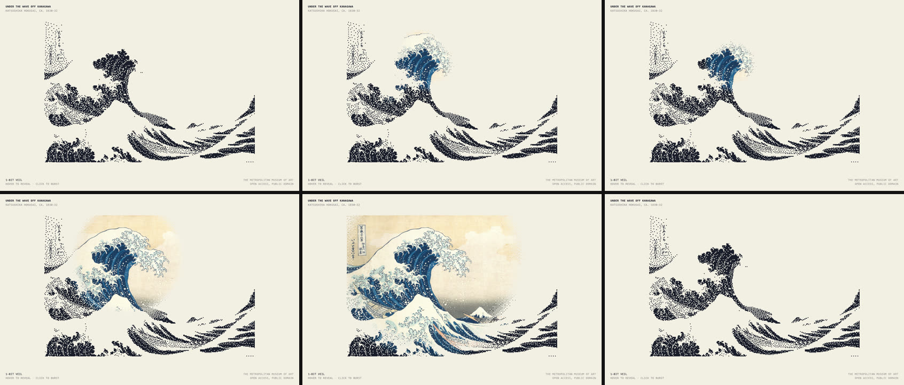

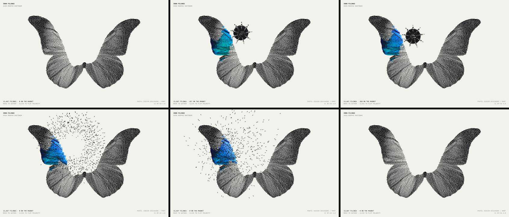

*Each sheet: idle, sweeping, parked, click, click + 0.5 s, healed, captured by `scripts/shot.mjs`.*

- `SKILL.md`: how both modes work, the workflow (image → scaffold → tune → contact sheet), rules and limits.
- `template/`: the engine (`engine.js`, both modes, no dependencies) and a page shell configured through `window.DITHER`.
- `scripts/new.sh <dest> <image> [veil|filings]`: scaffold a page from any image. `prep-image.py` cuts the subject off a plain background and embeds it, so the page runs from `file://`.
- `examples/`: `great-wave` (veil), `morpho` (filings), `geode` (a standalone raymarched specimen plate with a cross-section lens, a scroll-controlled cut and click-to-split).

**Controls:** move to reveal or gather filings, click to burst or flip polarity. On the geode, scroll moves the cut.

Inspired by a screen recording of a "Dither Veil" hover demo; the code is original. The Great Wave is from [The Met's Open Access collection](https://www.metmuseum.org/art/collection/search/45434) (public domain). The morpho photo is by [Didier Descouens / MHNT](https://commons.wikimedia.org/wiki/File:Morpho_rhetenor_rhetenor_MHNT_dos.jpg), [CC BY-SA 4.0](https://creativecommons.org/licenses/by-sa/4.0/).

## pixel-rebuild

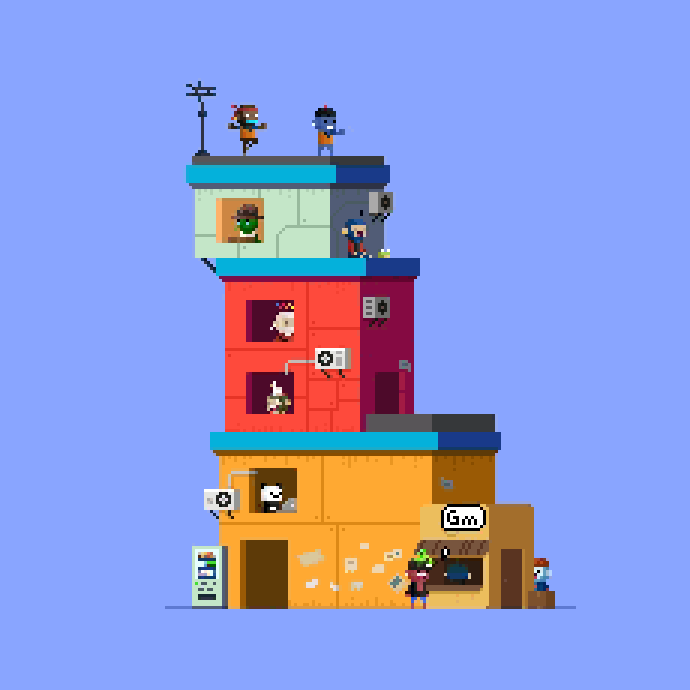

*A 15.5 s reel of a pixel-art tower rebuilt as a canvas page, exported with `scripts/check.py --gif`. In Chrome, each frame averages 0.26 clearly wrong pixels out of 52,900.*

- `SKILL.md`: how the grid is found and the clip is split into a background, sprites and a palette; the workflow (contact sheet → extract → check images → Chrome check); how to read the log, the knobs, and the traps already hit.
- `scripts/extract.py <clip> --out <dir>`: a video, GIF or screen recording in; `data.js` and the player out. It handles non-integer upscales, offsets, non-square art, and 30/60 fps recordings of slower art.
- `scripts/check.py <dir> [--gif out.gif]`: compares every rendered frame with the source in real Chrome, times playback, and writes a GIF with per-frame holds.
- `template/index.html`: the zero-dependency player.

**Controls:** space to pause, ← → to step, `m` for sound (when the clip has audio).
**URL options:** `?f=N` opens paused on frame N; `window.pixel.seek(n)` from the console.

The tower art isn't mine. It's rebuilt from a pixel-art reel by its original artist and shown here only to demo the pipeline. The code is original.

## postage-collage

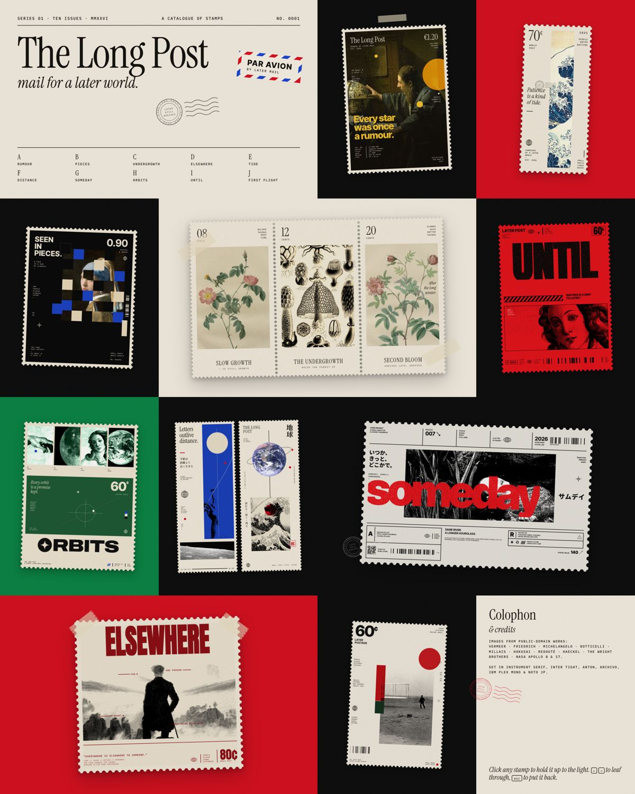

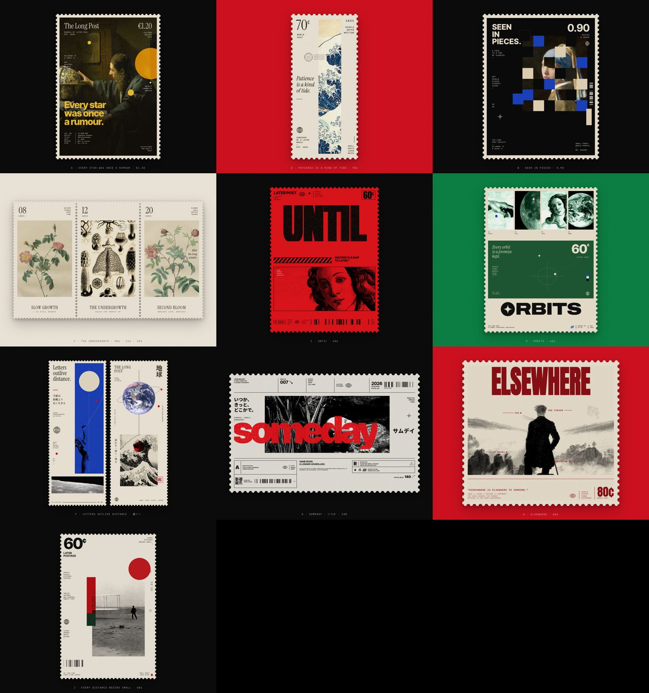

- `SKILL.md`: what makes these read as stamps (perforation, denomination, stacked micro-copy, one human line, treated imagery), the workflow (reference frames → concept → images → scaffold → write → screenshot check), the system rules, and image lessons.
- `references/families.md`: the ten families: the parts of each, sizes, the image it needs, the treatment and the copy rules.
- `assets/stamp.css` + `stamp.js`: the shared runtime: perforation mask, paper grain, speckle, icon kit and postmark, seeded barcodes and QRs, pixel-fragment grids, entrance and zoom view.
- `template/`: the page shell plus one snippet per family. `scripts/new.sh <dest> [family …]` puts together a page that renders immediately.
- `scripts/images.py`: Wikimedia Commons search and fetch, then crop and grain from a `recipes.json` (duotones are CSS blend modes, so one bw file serves every palette). `ref-frames.sh` pulls unique designs out of a reference reel, and `shot.sh` makes desktop, phone and per-stamp screenshots.
- `examples/the-long-post/`: the finished set, "mail for a later world".

**Controls:** hover lifts a stamp; click opens it full-screen; ← → leaf through; `esc` closes.
**URL options:** `?z=N` opens stamp N, `?still` skips the entrance animation.

Inspired by a reel of editorial stamp designs; the stamps, copy and code are original. Every image is public domain: Vermeer, Friedrich, Michelangelo, Botticelli, Millais, Hokusai, Redouté, Haeckel, the Wright brothers (1903) and NASA Apollo 8 and 17, via Wikimedia Commons.

## motion-reel

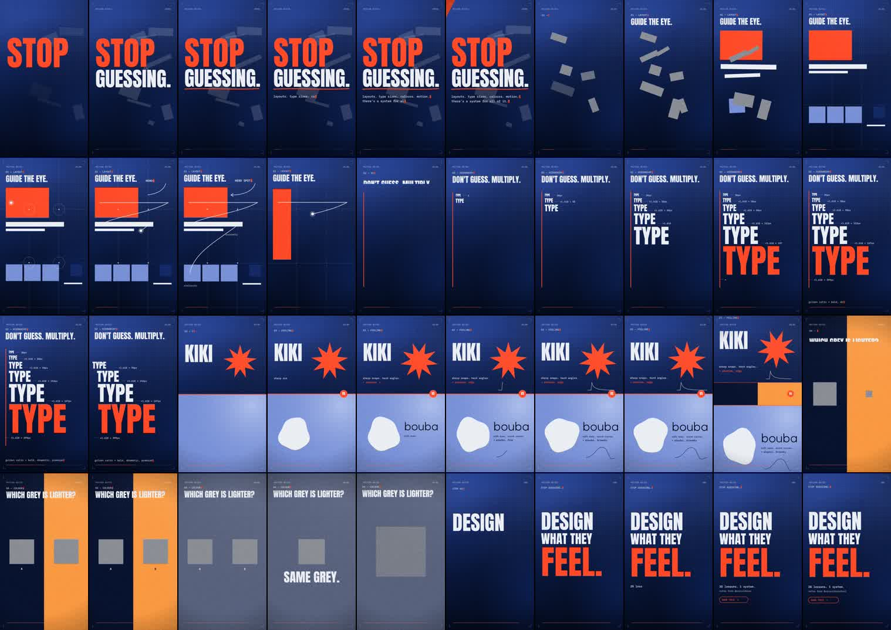

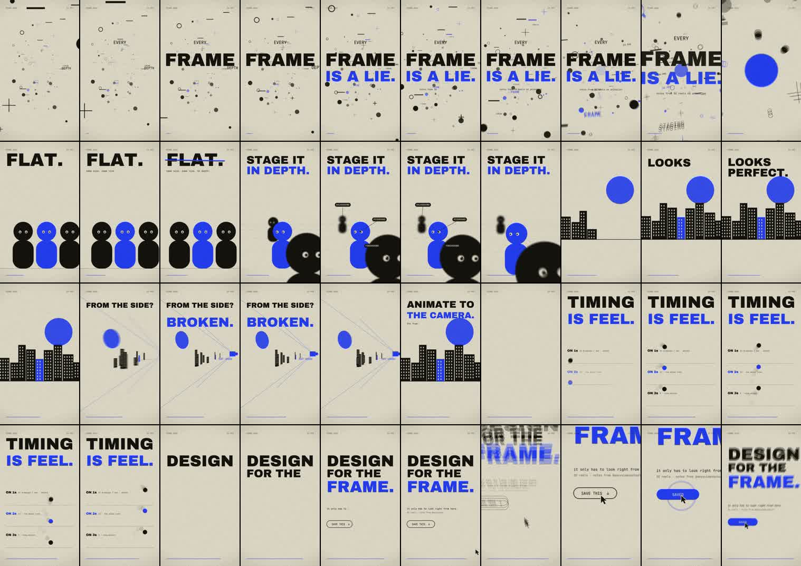

- `SKILL.md`: the workflow (brief → timing table → theme → edit scenes → music map → preview stills → render → verify → compare versions), and engine notes (skia + ffmpeg pipe, a tiny pinhole 3D camera with perspective cards, depth of field, sub-frame motion blur, on-twos timing, grain blend modes, SFX synthesis).
- `templates/flat-poster/`: *STOP GUESSING*. Hook slam, Gestalt layout snapping to a thirds grid with an F-path eye trail, a ×1.618 type ladder, kiki vs bouba easing, colour-is-relative, and a match cut to the end card. Procedural 120 BPM sound design.
- `templates/depth-camera/`: *EVERY FRAME IS A LIE*. A Fight-Club-style dive, flat → foreground/mid/background staging with depth of field and parallax, a city that is perfect from the shot camera and broken when the camera orbits, ones/twos/threes, and a cursor click with auto-zoom. Cut to Mixkit's "Stylz".
- `references/lessons.md`: design and animation rules learned from 30 @aevyvideoschool reels, a checklist, and an honest comparison of the two templates. `references/styles.md`: the 11 visual styles those reels use, one card per reel, and a build recipe per style.
- `scripts/`: `fetch-fonts.sh` (OFL fonts), `study-reels.sh` (contact sheets, cut counts, 4 fps bursts of reference videos), `pick-music.py` (list and fetch Mixkit tracks, BPM and steadiness, a 0.25 s energy/kick map, a 20 s loudness-normalised cut).

Made by studying a set of motion-design tutorial reels frame by frame, then rebuilding what they teach as code. Music isn't included: Mixkit tracks are free to use but not to redistribute, so `pick-music.py` fetches them.

## signal-print

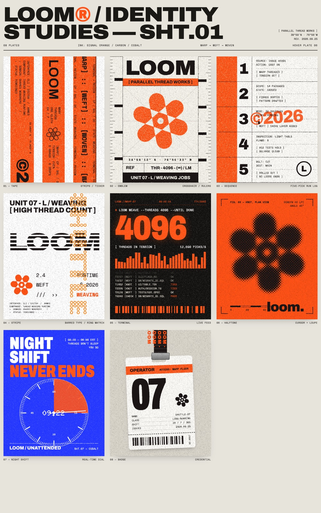

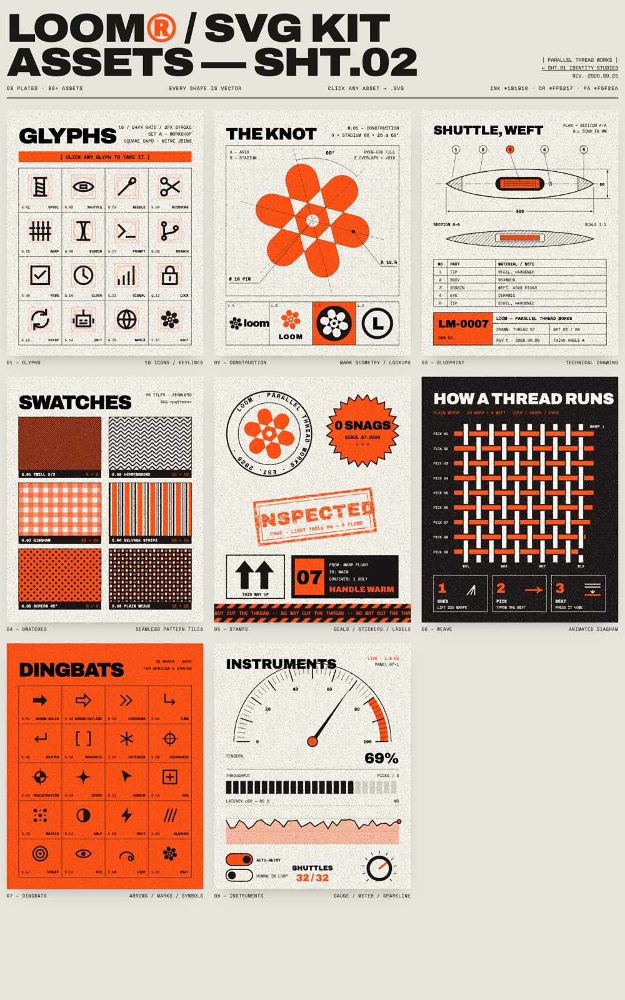

- `SKILL.md`: the workflow (read references → invent a product and one metaphor → design a one-path mark → scaffold → rewrite copy → screenshot check) and the short rules of the look.
- `references/grammar.md`: tokens, type, copy rules, how every plate on both sheets is built, the SVG export, and the traps already hit.
- `examples/loom/identity.html`: eight HTML/CSS/canvas plates sized in container units.
- `examples/loom/svg-kit.html`: eight all-SVG plates. Every asset is a nested svg; clicking one downloads it, with its patterns, markers and filters included.
- `scripts/new.sh <dest> --name X --accent '#hex'`: copies both sheets and swaps the wordmark and colours. `scripts/shot.sh`: full-sheet headless Chrome screenshot.

**Controls:** hover plate 06 on sheet 01 for the halftone loupe; hover and click any asset on sheet 02 to download it.

Inspired by grainy orange agent-deployment posters from a dev-tool launch campaign; the brand (LOOM), mark, copy and code are original.

## isometric-svg

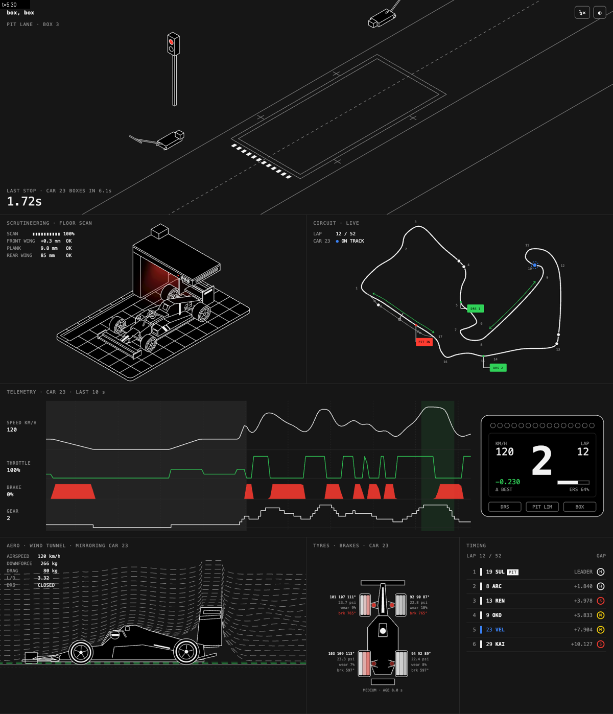

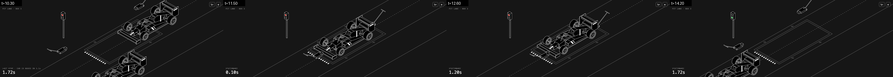

- `SKILL.md`: the look, the workflow (reference → axes → block out → painter's order → pure `state(t)` → verify) and the lessons that each cost a round trip (near-miss alignment, the twin bug, props left in a lane, loop seams, lap fractions that must wrap).
- `template/iso.js` + `template/index.html`: the engine (projection, `box`, `extrude`, `cylinderU`, `tube`, `slab`, `clipD`…) and a starter scene with a freeze hook and light/dark tokens.
- `examples/filing-cabinet.html`: drag the drawers out by their handles; hanging folders sway with inertia.
- `examples/pit-wall.html`: pit stop (jacks swing in from one side, four-corner tyre change, pit light, rivals in the fast lane), scrutineering gantry with a red glow, circuit map with DRS and pit lane, telemetry strip chart and steering-wheel display, wind-tunnel streamlines with DRS, tyre temps and brakes, timing tower — all on one clock. Cars, numbers and codes are fictional.
- `references/primitives.md`, `references/verification.md`: the API and painter's order rules, and the scripted checks (collisions, crossings, monotonic motion, loop seams) that caught real bugs.
- `scripts/shoot.py`: `uv run` it to freeze a page at a list of times and tile a contact sheet; fails on console errors.

Inspired by a screen recording of an isometric SVG filing cabinet and a pit-wall illustration; the code and scenes are original.

## motion-replica

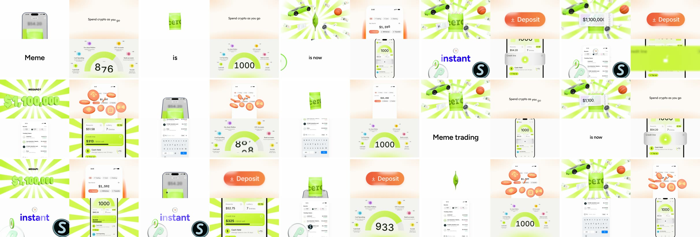

- `SKILL.md`: the workflow (measure → beat tables → scaffold → build flat and compare stills → 3D lookdev → motion sheets → final render and an honest diff report) and the principles behind it.
- `scripts/`: `study.py` (spec, per-cell loop periods and cuts, contact sheets, `--burst` strips for reading curves), `render.py` (page → MP4 or stills on the real GPU, audio muxed, `--probe`), `compare.py` (reference | replica stills and per-cell motion sheets), `prep-glb.sh` (meshopt + webp, material names kept, base64-embedded), `font2typeface.py` (any TTF → three.js 3D type).
- `templates/replica/`: `lib/replica.js` (pure-`t` timeline core, easing, number-flow odometer, sunburst, UI icons, boot), `assets/assets3d.js` (the 3D kit: crimped pouch, bills and stacks, basketball, diver's watch, lathed coins incl. glass-glyph and cel-shaded, bevelled digits, GLB loader), a demo page and a lookdev sheet.
- `examples/cero-grid/`: four independently looping cells (a pack-opening prize burst, a deposit flow with coin burst, meme-token search with coins flying into the list, a credit score gauge unlocking a credit line). Run `./fetch-assets.sh` once for the car.
- `references/`: `study.md` (reading timing, curves, counters, colour and type off frames), `timeline.md` (layers, coordinates, beat recipes), `3d-assets.md` (kit API, material recipes, licence-clear model sourcing), `gotchas.md`.

Made by rebuilding a 10 s grid ad frame by frame. The example's brand names come from that reference; the code and 3D assets are original, and the car is "Car Concept" by Eric Chadwick / Darmstadt Graphics Group (CC-BY 4.0), fetched at setup, not stored in the repo.

## spider-verse-look

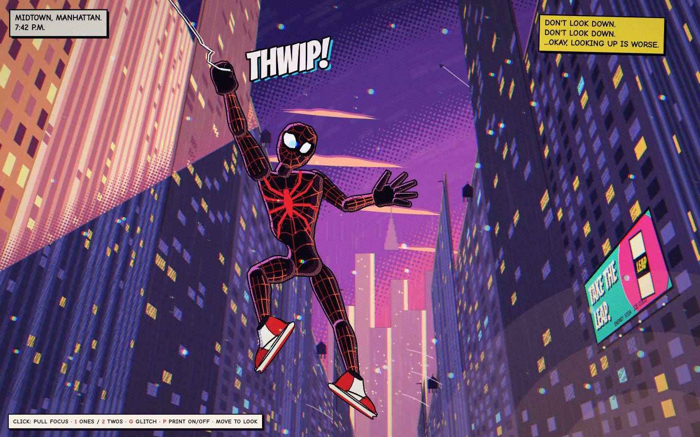

- `SKILL.md`: the workflow (pick the beat and its rules → construct and paint the world → draw the character from joints → letter it → print pass → verify by looking) and the rules that matter most.
- `references/style-bible.md`: what replaces each CG default (gradients, depth of field, motion blur, bloom, rim falloff, accurate geometry), plus line, colour and light, shape, camera, texture, timing, lettering and a pre-ship checklist, each attributed to a page of the book.
- `references/characters.md`, `environments.md`, `fx.md`: every character (heads tall, primitive shape, palette, render rule), every location, and every effect (focus, speed, spider-sense, Venom Strike, invisibility, glitch, quakes, portal).
- `references/book/`: the full extraction, one file per 35 pages, with attributed insights, page-by-page visual notes with sampled hex and code recipes. `references/video-making-of.md`: notes from a making-of video with timestamps.
- `engine/svpaint.js`: the painting kit. Limb contours, perspective walls from vanishing points, image warping, dry brush, spray, brush-pen ink, dot screens, hatching, stacked-silhouette toon light, on-twos timing, and a WebGL compositor for misregistration, grain and glitch. Classic script, opens from `file://`.
- `examples/dont-look-down/`: the finished painting. Click pulls focus between Miles and the city; `1` / `2` put Miles on ones or twos; `G` glitches; `P` toggles the print pass.
- `scripts/`: `shot.mjs` (GPU headless screenshots with JS between frames) and `serve.mjs`.

Built from *The Art of Spider-Man: Into the Spider-Verse* (Ramin Zahed, Titan Books, 2018) and "Making Spider-Verse Was Absolute Chaos" (PM. Films). Quotes are short and attributed; the book's text and art are not included. The example is fan art; Spider-Man and Miles Morales are trademarks of Marvel.

## sketch-storyboarding

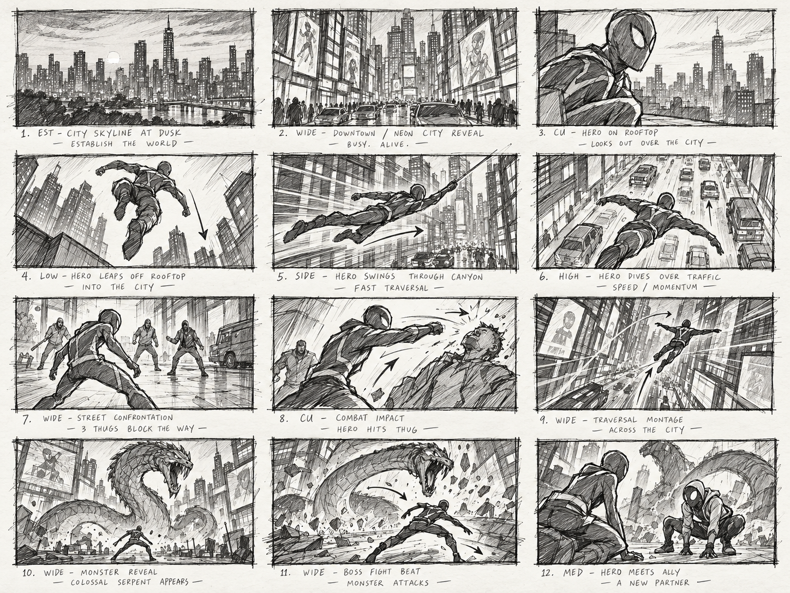

- `SKILL.md`: the workflow (read the clip → plan the shots in `board.json` → approve a blank lettered sheet → draw panels → letter and assemble → check), plus camera grammar, readable action and boss beats, a trailer arc, how to re-direct existing footage, output modes and a quality checklist.
- `scripts/shots.py`: cuts a trailer or gameplay clip into shots with ffmpeg's scene score, merges flash frames, samples long takes every few seconds, and writes numbered contact sheets with timecodes plus `shots.json`.
- `scripts/sheet.py`: `board.json` → the finished sheet with hand-ruled frames and hand lettering (Architects Daughter), empty frames for panels not drawn yet, `"mode": "pairs"` for CURRENT / PROBLEM beside REDIRECTED / PROPOSED, and `--prompts` to build per-panel and one-shot sheet prompts that fit Meshy's 600-character limit.
- `examples/trailer/`: the 12-shot trailer plan the reference sheet was drawn from.

Example requests:

> Storyboard this 70-second game trailer. Find the weak camera shots, redesign them, then make a 15-panel board with shot numbers, camera directions and action arrows. Keep the characters as simple figure sketches.

> Storyboard this boss intro as 8 rough pencil shots. The creature should feel enormous: detail reveal, low-angle scale shot, attack setup, hero reaction, dodge, impact, aftermath, stinger.

Drawing the panels needs an image model (the skill uses the Meshy tools when they're connected and asks before spending credits). The reference sheet is AI-generated fan art; Spider-Man is a trademark of Marvel.

## hairline-create

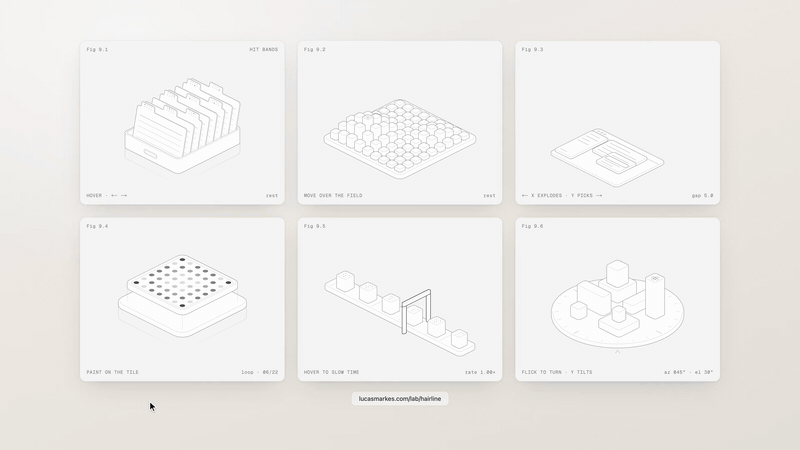

- `SKILL.md`: the workflow (offer two or three concepts → write one figure → build, validate and look → hand over → adjust) and a table of what goes wrong (labels, colour, timers, twelve-edge boxes, flat rest poses).
- `concepts.md`: how to find an object and a gesture worth a figure. `rules.md`: the ten rules a figure must keep.
- `kernel.js`: the fixed engine (iso projection, rounded prisms, springs and tweens, the stage). The figure only calls what the index at its top lists. `bench.html`: the fixed page the figure is assembled into.
- `examples/terrain.js`, `examples/riffle.js`: two of the library's figures in the format the skill writes, one continuous field and one set of discrete items.
- `build.mjs`: `<name>.js` → `hairline-<name>.html`. `validate.mjs`: checks the kernel and bench are untouched and the figure passes the static rules.
- `look.mjs` + `look.md`: builds, validates and shoots eight pictures onto one contact sheet, checks the frame, read-out and console, then twelve questions to answer from the sheet. Installs `playwright-core` once into a cache folder outside the skill.

**Use:** `/hairline-create a mailbox whose flag rises as the pointer gets close`, or just ask for a new Hairline figure.

Copied unchanged from [lucasmarkes/hairline](https://github.com/lucasmarkes/hairline/tree/main/skills/hairline-create) (`c3692e0`) by Lucas Marques. MIT: see the skill's `LICENSE`. The preview is upstream's `assets/hero.gif`. Live figures: [hairline.lucasmarkes.com](https://hairline.lucasmarkes.com).

## fframes-fx

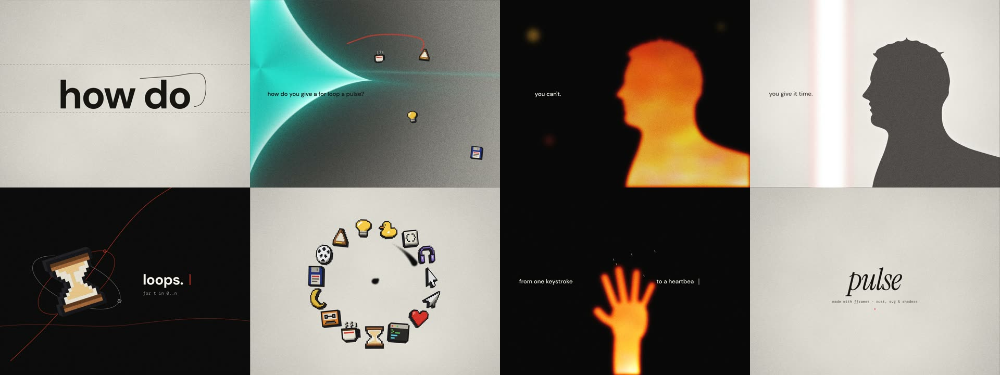

*Frames from `pulse`, the 21 s test film: paper grain, a glow-star shader, a thermal figure made with SVG filters, original pixel icons, word cards and an italic wordmark, with a synthesized score.*

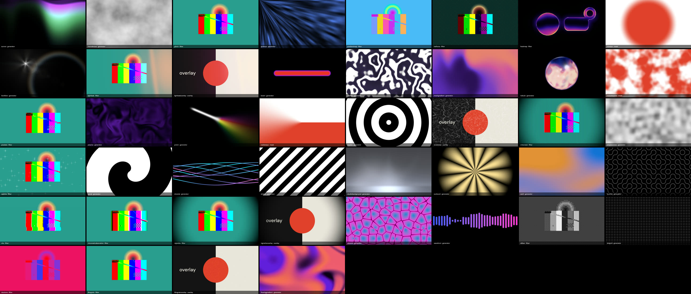

- `SKILL.md`: setting up an fframes video, how each kind of effect composites (generators, overlays with `mix-blend-mode`, filters on images and video, masks for transitions), what fframes can't do (no SVG-to-texture, no shader chaining) and the workarounds, a thermal-camera recipe in pure SVG filters, every gotcha hit while making the film, and the review loop.
- `shaders/`: 44 effects as `.sksl` files. Each header declares its kind, blend mode and every uniform with its upstream default.
- `templates/fx.rs`: drop-in loader. `Fx::parse` reads the header, `draw(frame, overrides)` / `filter(frame, image, ..)` apply defaults with overrides by name.
- `gallery/`: an fframes project that turns every effect into a 2 s scene named after it, with `--check` (Skia compile of all 44). `scripts/compare.sh` puts the upstream cover next to the port; `scripts/catalog.py` rebuilds `references/effects.md` from the headers.
- `references/`: `effects.md` (the catalog), `porting.md` (upstream conventions, TypeGPU → SkSL, color and alpha, shape effects, traps from the first 44 ports), `fframes/` (upstream fframes API, design and audio docs).

**Use:** ask for a video made with fframes, or for a shaders.com look inside one; `/fframes-fx` to port another effect.

Effects ported from [shader-effects-inc/shaders](https://github.com/shader-effects-inc/shaders) (`935f71a`, MIT, © 2026 Shader Effects Inc.); fframes and its docs by Dmitriy Kovalenko ([dmtrKovalenko/fframes](https://github.com/dmtrKovalenko/fframes) `30b48f3`, MIT). Both licences are in the skill. About 30 upstream effects (simulations, cursor and compute effects) don't fit a one-pass SkSL layer and are not ported. The film's copy, icons, figures and score are original.

## frosted-figure

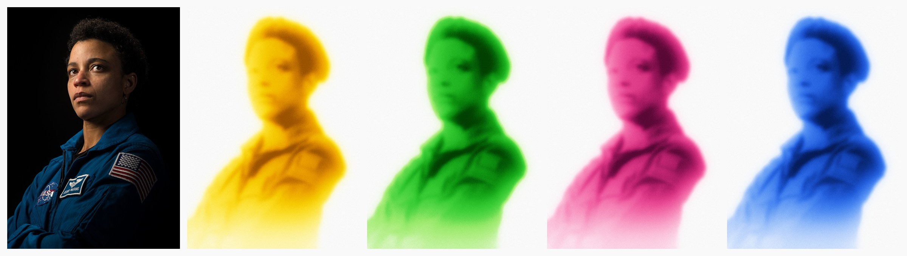

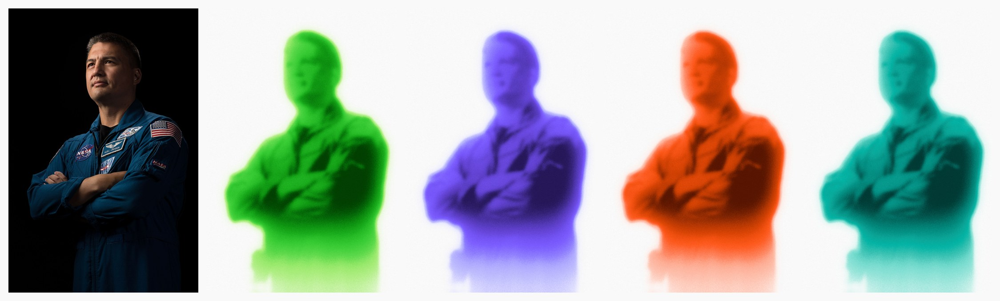

*Source photo, then the renders. Above: the four named palettes. Below: green, then palettes generated from `#7b5cff`, `#ff5a1f` and `#00b3a4`.*

- `SKILL.md`: how the effect is built (cutout → density from photo shadows and depth into the figure → two frosting blurs → bottom fade → gradient map and grain), the workflow, rules and limits.
- `template/frost.js`: the effect with no dependencies. Auto-levels the shading on the person alone and sizes the blur from the head, so low-key, high-key, close-up and half-body photos work without tuning. Includes a colour-key cutout for plain or graded studio backdrops (a RANSAC backdrop fit that ignores clothing running off-frame).
- `template/index.html`: MediaPipe person segmentation in the page, plus a by-hand mode: drop a photo, switch palettes, pick any colour, save a PNG.
- `scripts/render.mjs <photo> [out] --palette yellow,green,pink,blue`: renders PNGs in headless Chrome (Node 22+, no npm deps) and prints the values the auto options chose. MediaPipe is cached on first run so later runs work offline. `scripts/sheet.py` builds comparison sheets.
- `references/tuning.md`: every option, what each kind of photo needs, and the failure modes with fixes.

**Use:** hand over a photo of a person and ask for it frosted / as a gradient figure / in a set of colours, or run `/frosted-figure`.

Example photos are official 2021 NASA portraits of [Jessica Watkins](https://commons.wikimedia.org/wiki/File:Jessica_Watkins_Official_NASA_Portrait_in_2021_(cropped).jpg) and [Kjell Lindgren](https://commons.wikimedia.org/wiki/File:Kjell_Lindgren_Official_NASA_Portrait_in_2021.jpg) (public domain, via Wikimedia Commons). The person cutout uses [MediaPipe](https://github.com/google-ai-edge/mediapipe) `@mediapipe/tasks-vision` (Apache-2.0) and its `selfie_multiclass_256x256` model, both downloaded at runtime and not included here. The look is after a frosted-glass green figure image seen on Pinterest; the code and palettes (sampled colour values) are original.

## motion-prompts

- `SKILL.md`: how to pick and adapt a prompt, what the prompts that worked have in common (a length and a bar instead of a storyboard, research before design, real assets, cuts on the beat, frames as a pure function of time, the giveaways to avoid), and a generated index of categories, reusable briefs and the four shared skills.
- `prompts/<category>.md`: 11 files. Each starts with the reusable briefs (`<inputs>` templates, `[product]` / `{{PRODUCT}}` placeholders, long fully specified briefs), then lists the rest with the most-reused prompts first. Each entry has the creator, date, video, gallery page, and tag chips for stack, iterations, effort, aspect ratio and language.
- `data/prompts.json`: all 231 entries as data. `data/categories.json` (committed): the categories and the slug → category assignment.
- `scripts/update.py`: `uv run scripts/update.py --fetch` re-scrapes the site from the Next.js payload each page embeds, so no browser is needed. New entries go to `prompts/uncategorized.md` until they get a category.

**Use:** ask for a motion video, launch film, showreel or explainer and for a prompt or brief to start from, or ask what other people prompted for something similar.

Prompts and videos belong to their creators, and every entry credits and links the original post. The gallery is curated by [@p4nthera_](https://x.com/p4nthera_).

## typographic-sticker-ui

- `SKILL.md`: typography first and UI second. It covers type pairings and how far to break convention; inline visual interruption ("I love [BUILDING sticker] things with [AI sticker]…"); Pinterest searches for sticker references; sticker treatment (cutout borders, tape, rotation, grain); widgets embedded in the sentence; asymmetric layout; colour; interaction and motion; content density; and a closing checklist.

**Use:** ask for a portfolio, personal site, landing page or dashboard in an editorial, sticker or collage style, or name the skill.

The twelve reference images the skill was written against are other people's work collected from Pinterest. They are in `reference_images/` for personal reference.

## app-designer and web-designer

Both skills are by [Tobia Donadon](https://www.tobiadonadon.com) and are copied here unchanged. They are not covered by this repo's MIT licence. Each renders through your own Chrome with `playwright-core`, so run `npm install --no-fund --no-audit` once in the skill folder. app-designer needs a Mac for Apple's fonts. web-designer runs on Mac, Windows or Linux; its stand-in fonts are open-licensed (see `assets/fonts/LICENSES.md`).

## kawaii-pink

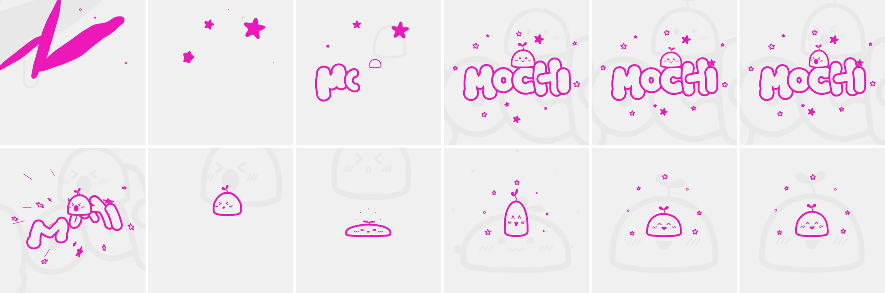

*The template's film: smears snap into stars, MOCHI inflates letter by letter, the mochi mascot blinks, slurps the logo, splats flat, stretches tall and settles.*

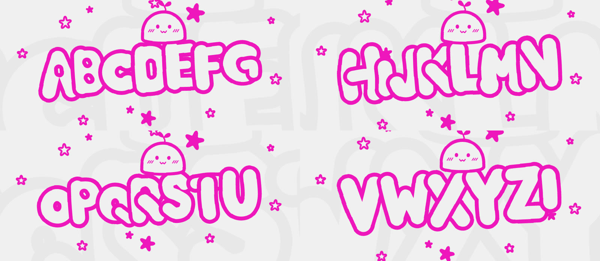

- `SKILL.md`: making a sting with any word, ink colour and mascot seat; how it works (everything is point lists, bubble letters as two strokes with seams and counter pills, the distance-delayed slurp warp, the 3.1x echo, the boil on twos, smear-to-star morphs, volume-keeping squash); retiming; recreating another reference; gotchas; review loop. Original characters only: if a reference uses a known mascot, the motion is kept and the character and word are swapped.
- `template/`: the fframes project. `glyphs.rs` is an A-Z bubble alphabet, `mascot.rs` holds the mascot's states and drawing, `tools/gen_audio.py` synthesizes every sound, and `tests/` inspect every frame for the default word and the whole alphabet.
- `scripts/study.sh`: downloads a reference with yt-dlp and measures it: contact sheets, palette and ink guess, ink coverage per frame (beats), frame-to-frame change (on twos?), audio envelope. `scripts/compare.sh` puts the reference next to the render.
- `references/`: `beats.md` (the measured beat sheet and the constants that drive it), `lettering.md` (slit and counter rules, adding glyphs), `mascots.md` (designing an original mascot, face kit, squash numbers).

**Use:** ask for a cute / kawaii / bubble-letter logo animation or mascot sting, or to rebuild a short 2D logo animation from a clip.

Motion modeled on a logo sting by [G4K Motion](https://x.com/G4K_Motion). The mascot, lettering, code and sound are original.

## anatomy

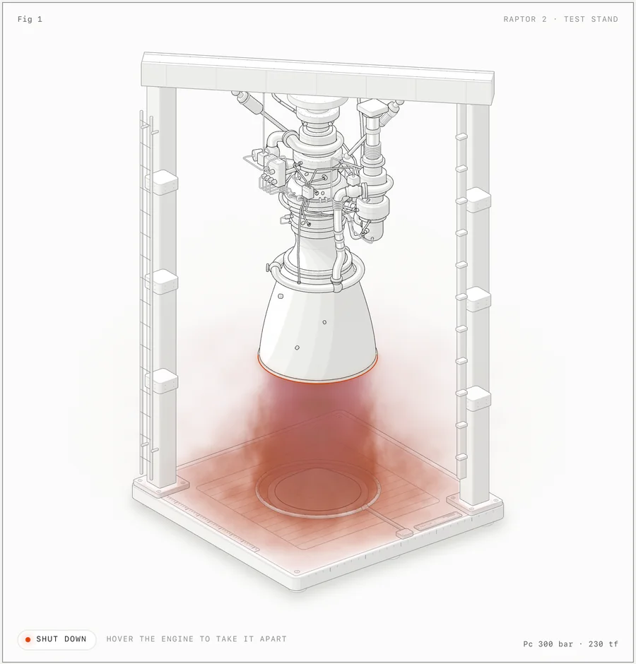

*`examples/raptor-engine`, light theme, firing. The engine and stand are SVG; the plume is a WebGL shader in the same isometric camera.*

- `SKILL.md`: the one idea (the object is the explanation: invent a real machine whose working *is* the concept) and the workflow: size it as a Figure, Hero or Epic, collect the true numbers, invent the object, write a parts list of 40+, build geometry once, paint back to front, frame it in a card, make it live, then verify like a critic (audit, line check, 4× close-ups in both themes).
- `kit/`: zero-dependency modules for isometric solids, lathed round parts, tubes and cables, depth sorting, shaders and an audit (`kit/audit.mjs`) that proves nothing passes through anything at rest, apart and in every frame of an explode.
- `examples/`: eight complete figures (dial indicator, desk computer, arcade cabinet, Raptor engine, ripple tank, test rig, spot plate, turning dial). Test rig and spot plate are React/Next production figures and turning dial is the 3D mode; the framework-free ones build with `node examples/<name>/build.mjs` (`--light` for the light theme).
- `references/`, `scripts/`, `evals/`: the deeper guides, capture and check scripts, and the skill's eval set.

**Use:** ask for an isometric illustration, a technical figure for docs or a post, or an interactive explainer of how something works. Needs Node 20.10 or later.

Copied unchanged from [wheresryan22/anatomy](https://github.com/wheresryan22/anatomy) (`dbf697a`), with its MIT `LICENSE`. By Ryan; see [skills.wheresryan.sh/anatomy](https://skills.wheresryan.sh/anatomy).

## launch-promo

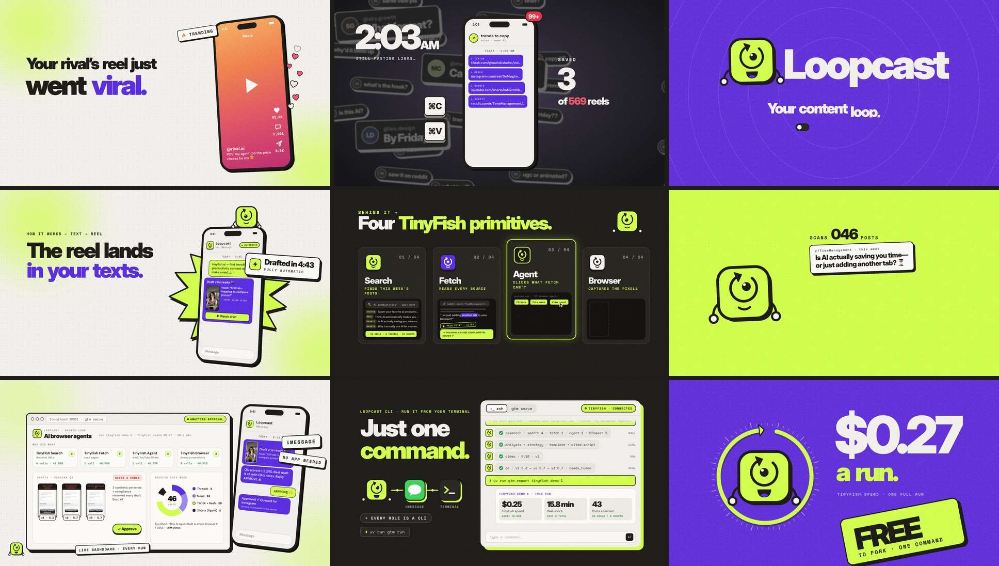

*`examples/loopcast`: a 57.5 s, 9-scene launch film for Loopcast, a TinyFish-powered growth agent. Every number on screen comes from two real runs.*

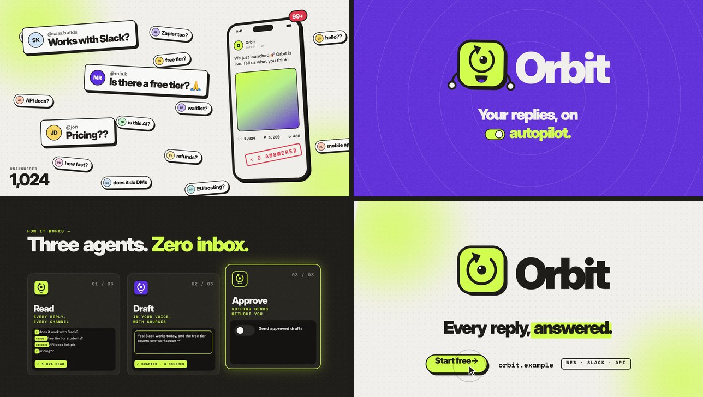

*`template/`: the 20 s starter for a placeholder product (Orbit). It renders before any API call.*

- `SKILL.md`: the workflow (collect the product truth → pick the shape, with or without a reference → script against target beats → build scenes beat by beat → voice, music and SFX → check the cut and render), plus starting from the Loopcast example.
- `template/`: one HTML page where `seek(t)` is pure: scenes, components (mascot, phone, stickers, toggles, keycaps, cursor), and `vo.py`, `music.py`, `audio.py` and `render.py` for the ElevenLabs voice, ElevenLabs Music, synthesised SFX with ducking, and parallel headless-Chromium rendering with motion blur.
- `examples/loopcast/`: the full film as an overlay on the template, with the real placed word timings.
- `scripts/`: contact sheets, Whisper line timings, palette sampling and motion density for studying a reference.
- `references/`: `aesthetic.md`, `motion.md`, `text.md`, `structure.md` (the 9-beat map), `audio.md`, `gotchas.md`.

**Use:** ask for a launch video, product promo or motion-graphics ad for your own product, or share a promo and say "make one like this". Needs `uv`, `ffmpeg` and Playwright's Chromium; an ElevenLabs key for voice and music.

Structure and timing studied from the DMflo launch promo (motion by [@that.product.guy](https://x.com/that.product.guy)). The scenes, mascot, code and audio are original.

## 3d-deep-explainer

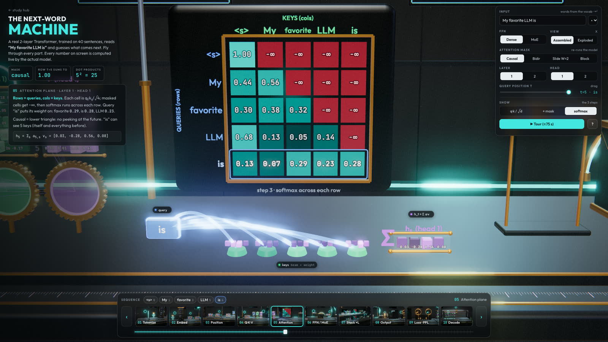

*`examples/next-word-machine`, the attention station: q·k/√d, the causal mask, then softmax across each row, with beams sized by weight. Every number comes from the live model.*

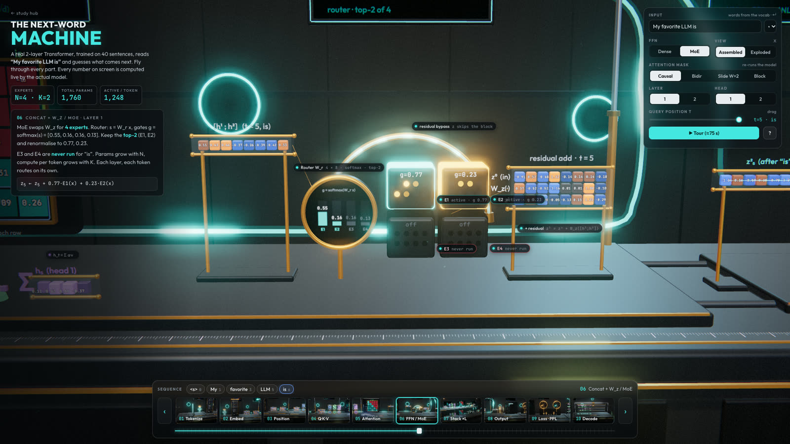

- `SKILL.md`: the workflow and why each step matters: find the true computation (a tiny real implementation, verified against a reference), design the machine (data flow → 6–10 stations, a table mapping concepts to physical objects), scaffold from the template, wire what-if toggles that re-run the real thing, write tight per-station explanations whose numbers match the screen, verify in a real GPU browser, record the tour. Ends with a checklist.
- `templates/`: a generic, runnable starter that opens from `file://` (three.js from a pinned CDN, no build step): the engine (renderer, studio lighting, bloom, camera rig and tour, labels, control panel, filmstrip, URL presets, deterministic `?record` mode) and a 3-station example (a soft lookup: dot-product scores → softmax with temperature → a weighted blend), plus `tools/` to check the JS numbers against a Python reference.
- `references/`: `design-language.md` (lighting, materials, palette and colour coding, type, overlay layout, camera moves), `engine-api.md`, `station-cookbook.md` (13 reusable parts with code: value-coloured vector bars, matrix planes, beams, Σ assembly, histogram, gauge, drawer cabinet, lens, router dial, growing shelf, residual arch, exploded stacks), `real-model.md` (training a tiny model with uv + torch so the numbers are readable, exporting weights, a JS forward pass that returns every intermediate, verifying it), `gotchas.md`.
- `scripts/`: `new_explainer.sh` (scaffold a new explainer), `shoot.py` (screenshots of every station at several widths, console errors, fps), `record.py` (frame-stepped tour → mp4 with ffmpeg).
- `examples/next-word-machine/`: a 2-layer, 2-head Transformer trained on a 40-sentence toy corpus, run live in the browser through 10 stations (tokenizer gate, embedding cabinet, positions, Q/K/V lenses, attention plane, W_z or MoE router, stacked layers, output lens, loss and perplexity gauges, decoder with a growing KV-cache shelf), with mask, dense/MoE, decoding and exploded-view toggles; plus its training, sweep, export and verify scripts. Built as an exam-review explainer for a graduate NLP course.

**Use:** ask for a 3D, interactive or fly-through explanation of how something works (an ML model, an algorithm, a data structure, a protocol, a physical or biological process), or share a 3D viz you want to emulate. Needs Chrome, `uv` and `ffmpeg`; `torch` only for the train-a-real-model path. three.js is MIT, loaded from a CDN.

## doc-shorts

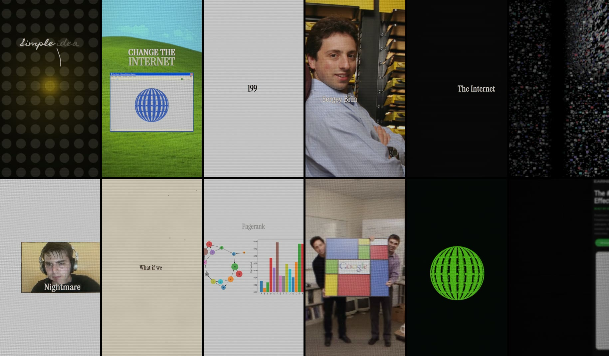

*`template/examples/google-origin`: a 27 s doc reel about how Google started at Stanford, rebuilt tick for tick through the generic engine.*

- `SKILL.md`: the workflow (facts and script → voice and word timings → a shot plan that picks a literal picture per phrase before picking a kind → archival pictures → render and review on contact sheets), studying a reference, and running the example.
- `template/`: the fframes crate (spec reader, shared look, 15 shot kinds, SkSL texture shaders) and `tools/` for ElevenLabs voice and music, Whisper word timings, rembg cut-outs, an Earth-plate baker and a reference-vs-ours comparison.
- `template/examples/google-origin/`: one spec file per shot, the plates, the reel's audio and reference video, and the scripts that built the plates; it doubles as the engine's regression test.
- `scripts/study.py`: downloads a reference reel and splits it into a frame per tick, contact sheets, cuts, word timings and the cadence.
- `references/`: `aesthetic.md` (what makes the look, and the rules for making a film your own instead of a copy), `pipeline.md`, `spec.md`, `shots.md` with a page per kind, `look.md` (the measured texture, type, palette and motion), `case-study.md`.

**Use:** ask for a short documentary or explainer reel about a topic, person, company or event, or share a doc reel whose look you want for your own film. Needs Rust, `ffmpeg` and `uv`; an ElevenLabs key for voice and music.

The example rebuilds a reel by EarnEdits.com ([Pinterest pin 1086986060090796381](https://in.pinterest.com/pin/1086986060090796381/)); its audio, reference video and photo plates belong to their owners and are credited in `examples/google-origin/assets/SOURCES.md`. The engine, kinds and tools are original.

## saas-promo


*Top: `examples/bolt-weekend`, bolt.new's 27.7 s "Bolt is free this weekend" promo rebuilt on the generic scene kinds. Bottom: `examples/mise`, an original film for a fictional restaurant site builder with another palette, flow, beat grid and synthesized music, and art-directed screens built from credited photos.*

- `SKILL.md`: the workflow (story beats → HTML screens rendered to PNG → palette → music, beat grid and snapped cuts → render and review on contact sheets), the scene kinds, how to make a film your own instead of a re-skin, gotchas.
- `template/`: the fframes crate (spec reader with seconds/beats and beat snapping, a palette-driven backdrop shader with 14 fitted framings, glass type, highlight boxes, a fake-3D camera, cursor and letterbox, 8 scene kinds) and `tools/` (`promo.sh`, `beats.py`, `bgm.py`, `palette.py`, `screens/render.py`, `bgfit/fit.py`, `cmp.sh`, contact sheets).
- `template/examples/bolt-weekend/`: the worked example, with `reference.jpg` (frames from the original) and `render.jpg` (ours at the same times), over an original synthesized track.
- `template/examples/mise/`: the original example: its HTML screens (a landing window, a neon taco-bar site, eight food-business cards and a collage poster), credited photos and cut-outs, and its synthesized track.
- `references/`: `screens.md` (art direction for the screens and a slop checklist), `spec.md`, `kinds/*.md` (params, defaults and measured timing per kind), `look.md` (every measured number and the rules of the style), `case-study.md`.

**Use:** ask for a product launch, feature or pricing promo, a SaaS ad or an app reveal with kinetic type, or share a promo in this style and say "make one for my product". Needs Rust, `ffmpeg`, `uv` and Playwright's Chromium.

The look and timings were measured on bolt.new's "Bolt is free for everyone, all weekend long" promo by StackBlitz; the original video and music are not included. Sources of the example's assets (the bolt.new wordmark, product photos and clip art inside the rebuilt screens) are in `examples/bolt-weekend/SOURCES.md`. The engine and the mise film's design, copy and music are original; its photos are credited in `examples/mise/SOURCES.md`.

## colorfigures

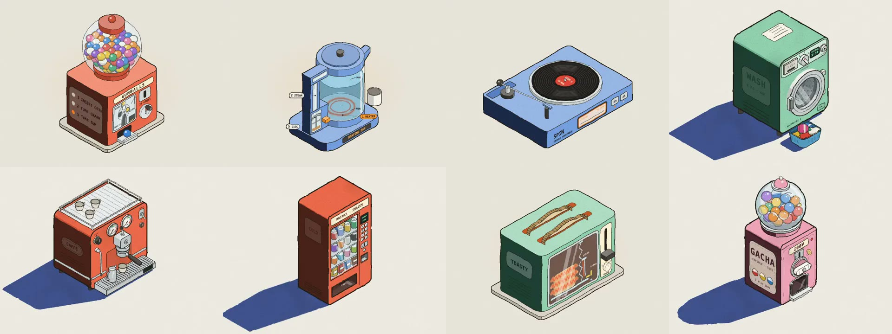

*Posters from [april-zhu.com/colorfigures](https://april-zhu.com/colorfigures). The top row's first three each came from a one-line prompt in a fresh install.*

- `SKILL.md`: the workflow (copy the engine, read the two examples, write one figure, look at it in headless Chrome for at most two rounds, build one file), the coordinate system and fixed view, the look (three-tone shading, ink weights, boards and cast shadows), scenes with several objects, painter's order, interaction rules (follow the real process, every supply comes from something in the scene, sensible out-of-order presses), labels for "how does it work" figures, and lessons from earlier figures.
- `assets/core.js`: the engine: projection, 3D shapes and shading, ink, labels, and the page with its buttons, swatches and wobble slider.
- `assets/examples/`: two editable figures to learn from (vending machine, washing machine). `scripts/build.py` inlines the engine so a figure runs on its own.
- `demo/`: three finished figures from the skill page (gumball machine, kettle, record player) with the prompts that made them, plus the page's posters and hover clips. Open any `.html` and press things.

**Use:** describe an everyday object in one line ("a record player: put on a record, drop the needle and it plays"), or ask how something works and say "make it a Colorfigure". Needs Chrome for the screenshot check and `python3` for the build.

Copied unchanged from April Zhu's [colorfigures.zip](https://april-zhu.com/colorfigures/colorfigures.zip) (identical to the copy on her page on 2026-10-18), with its MIT `LICENSE`. The demo figures and previews are from her [skill page](https://april-zhu.com/colorfigures); more are playable in the [live demo](https://april-zhu.com/colorfigures-demo). By [April Zhu](https://april-zhu.com) ([@Aprilzz423](https://x.com/Aprilzz423)), built on her [ISO-GLOW](https://isoglow.dev), which is built on [iso-figure](https://github.com/MrBongoC/ai-iso-skill) by Tolga Cohce.

## rossark-motion-skill

<a href="skills/rossark-motion-skill/demo/reveal.mp4">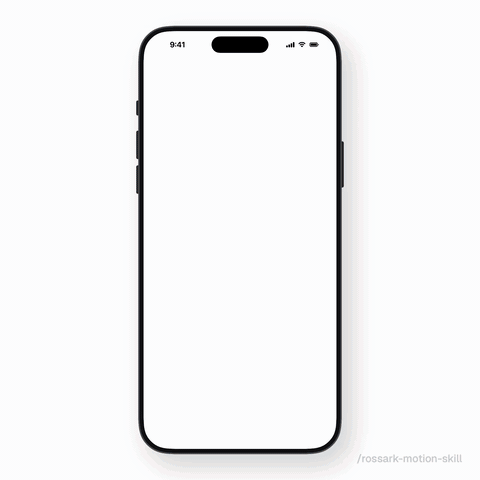</a>

*`demo/RevealScene.swift`, rendered in a phone frame at 60 fps with the skill's own SwiftUI engine. Every shape and every move is code.*

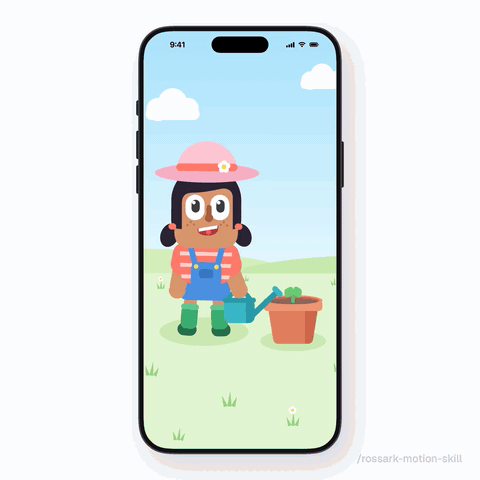 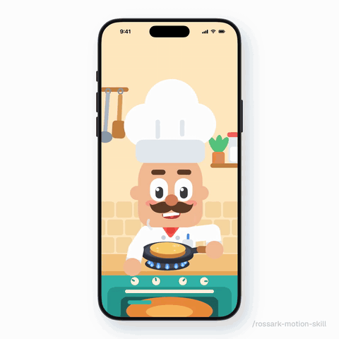 

*Garden, Chef and Orbit, the other three demo scenes.*

<a href="skills/rossark-motion-skill/examples/pond/pond.mp4"></a>

*Pond, an original example made with the skill's engine for this repo: a frog snaps at a firefly and misses, the firefly lands on its nose, and the frog goes cross-eyed.*

- `SKILL.md`: the method. Principles (never teleport, calm curves, small amplitudes, arcs around real pivots, overlap and follow-through, seeded variety, reduced motion means still), recipes by subject with starting numbers (tails, plants, cloth, fire, smoke, water, rain, lights, machines, icons, charts), live faces, full-body acting (moving holds, layered channels, bent limbs, 2.5D turns, weight shifts, landings, hanging feet, shadows that breathe with height, props and strikes, camera-angle builds), scenes told in beats, motion in an interface (after Emil Kowalski and Benji Taylor), pitfalls, working from a reference video, and a workflow.
- `MOTION.md`: a notes file to copy next to your art. Part 1 is the method in short; Part 2 is where the project's code, rules and limits go. The skill reads it first.
- `templates/`: the engine (`motion.ts`, `Motion.swift`: loop and one-shot clocks, `track`, `flow`, `seg`, `wave`, `loop`, `bell`, `seeded`, curves) and live eyes and mouths (`liveFace.tsx`, `LiveFace.swift`) for React Native and SwiftUI.
- `tools/`: `sheet.sh` (contact sheets at full frame rate), `track_edges.py` (measures 1-5% jiggles, floats and sways frame by frame) and `sample_colors.py` (exact colours from a video frame).
- `demo/`: the four scenes (reveal, garden, chef, orbit) as Swift source with MP4 and GIF renders, a phone mockup and `render.swift`, an offline renderer that writes PNG frames for ffmpeg.
- `examples/pond/`: an original scene added in this repo, built only from the skill's templates. It shows gaze aimed per eye (the eyes cross by themselves), a tongue strike that misses, contact solved through a floating pad, a hop with hanging legs and pad ripples, and a loop that closes without a jump. Its README maps each beat to the SKILL.md section it uses.

**Use:** ask to animate an illustration, mascot, icon or scene, to make something "feel alive", to add idle motion, or to recreate the motion of a reference video. Re-rendering the demos needs macOS 14+ with `swiftc` and `ffmpeg`:

```bash
cd skills/rossark-motion-skill
swiftc -parse-as-library -target arm64-apple-macos14 \
  templates/swiftui/Motion.swift templates/swiftui/LiveFace.swift demo/*.swift -o /tmp/render-demo
/tmp/render-demo reveal /tmp/frames phone fps=60   # or: garden, chef, orbit
ffmpeg -framerate 60 -i /tmp/frames/%04d.png -c:v libx264 -pix_fmt yuv420p -crf 20 /tmp/reveal.mp4
```

The skill's own files are copied unchanged from [rossark0/rossark-motion-skill](https://github.com/rossark0/rossark-motion-skill) (`9b20964`), with its MIT `LICENSE`. The demo scenes, renders and GIFs are from that repo too. `examples/pond` is the only addition: an original scene made with the skill's engine for this repo. By Ross ([@rossark0](https://github.com/rossark0), [thisross.com](https://thisross.com)). Its interface-motion rules follow [Emil Kowalski's skills](https://github.com/emilkowalski/skills) and Benji Taylor's [Family values](https://benji.org/family-values).

## photoreal-spot


*`examples/adidas-nba`: a 15.6 s spec spot for the adidas x NBA game ball. The player, hoop and rack shots are AI video made from photoreal stills; the opener and the collage are snap cuts with tracking boxes, cut on the soundtrack's hits.*

- `SKILL.md`: the workflow (study the reference and its track → plan shots on the hits → photoreal stills → AI video, credits confirmed first → plates and snap beats → render → QA against the reference), the rules learned on the example, gotchas.
- `template/spot.json`: a starter 15 s spot with an opener and a collage of snap beats, three video segments, HUD, tagline and end card.
- `template/tools/`: `study.py` (cuts, holds and a contact sheet of a reference), `hits.py` (onsets, breakdowns, dips and fade of a track, in frames), `unpack.py`, `plates.py`, `snaps.py` (cards, smears, black frames, fixed frames and Jev tracking boxes with trails, cached by frame content), `assemble.py`, `spot.sh`, `sheet.py`, `qa.py` (Jev per-frame and per-section scores, with the reference as the control), `new_spot.py`.
- `template/comp/`: the fframes crate that reads the same `spot.json`: backdrop gradient, plate grade, whips, chromatic-aberration kicks, flashes, the HUD with a shot counter, the tagline slam with an outline fill, logo flashes and the lockup, grain and vignette, the soundtrack.
- `examples/adidas-nba/`: the spot.json of the final cut, the still prompts, the Vizard briefs, the start stills and the Jev reports for the final cut and for a rejected version.
- `references/`: `look.md` (every measured number), `stills.md`, `video.md`, `snaps.md`, `soundtrack.md`, `spot.md`, `qa.md`, `case-study.md`.

**Use:** ask for a product or sports spot, a brand commercial with snap cuts or tracking boxes, or share a reference ad and say "make one like this for my product". Needs Rust, `ffmpeg` and `uv`; an image model for the stills, the Vizard CLI or Wan for the video, and a TypeSafe key for the boxes and QA.

The example is unsolicited spec work after Ali Zeyada's adidas x NBA case study on Behance; the reference, its soundtrack and the brand logos are not included. adidas, NBA and Spalding marks belong to their owners. The fonts are Barlow Condensed and IBM Plex Mono under the OFL (licences in `template/comp/licenses/`). The tools, comp and stills are original.

## dimensional-drawing and dimensional-drawing-motion

<a href="skills/dimensional-drawing-motion/demo/dialog-motion.mp4">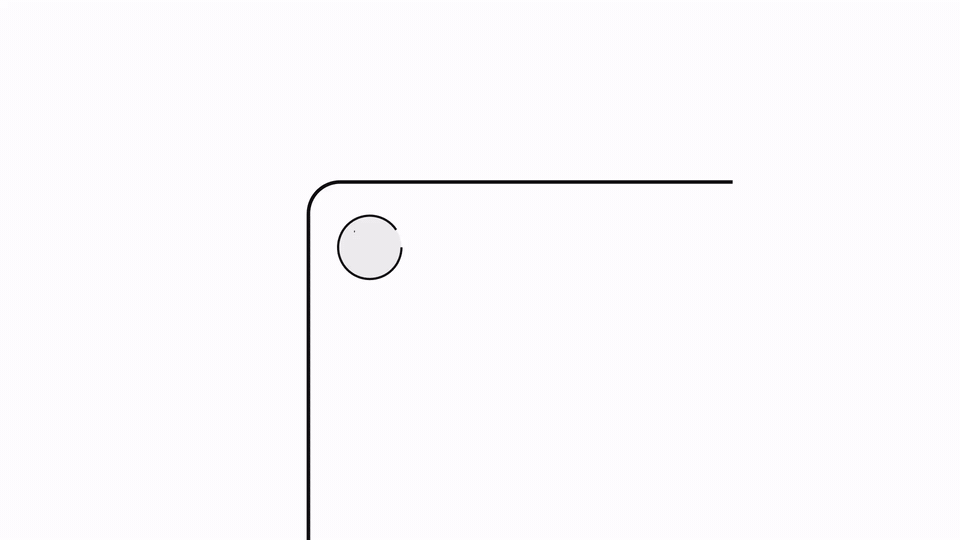</a>

*The reference film, `templates/scene-dialog.js`: the header draws up close, the camera pulls back to the plan, layers lift into the exploded view, then the full sheet.*


*`examples/dialog-sheet.html` (fixed width, scrim, viewport placement, header controls, footer actions) and `examples/card-sheet.html` (flexible width, body well, nested corner, shadow envelope).*

- `dimensional-drawing/SKILL.md`: the house rules (monochrome, architecture not content, variables not numbers, unbranded, never invent values), the code system (S spacing, H/Z/I sizes, R radii, the E1–E3 shadow envelope), the page and sheet layout, which views to add per component (card, dialog, button, navigation, physical products in third-angle views), how to measure a real component in Playwright, the SVG drawing kit (`dimH`, `dimV`, `callout`, `rad`, `detailRef`, `table`, `notes`) with its line conventions, and the checks before delivering.
- `dimensional-drawing/examples/`: the card and dialog sheets as single HTML files to copy the kit from. `demo/` holds their PNGs.
- `dimensional-drawing-motion/SKILL.md`: the choreography beat by beat, how the template works (one SVG and one camera with log zoom, `at()` registration, drawn vs faded elements, morph groups for the exploded view), adapting it to a new component, and the style rules for motion.
- `dimensional-drawing-motion/templates/`: the reference 11 s dialog film (`scene-dialog.js`) and its stylesheet.
- `dimensional-drawing-motion/adapters/`: `claude-motion.md` (build it as a claude.ai Motion artifact, the target it was tuned on) and `headless/` (`render.mjs`: Playwright renders each frame, ffmpeg encodes; `--still <t>` renders one frame). `demo/` holds the film as MP4 and GIF.

**Use:** "make a dimensional drawing of the `Card` component in `src/components/Card.tsx`", then "animate this drawing". Rendering headless needs Node 18+ and ffmpeg:

```bash
cd skills/dimensional-drawing-motion/adapters/headless && npm install
node render.mjs --scene ../../templates/scene-dialog.js --css ../../templates/base.css --out dialog.mp4
```

Copied unchanged from [enesozturk/dimensional-drawing](https://github.com/enesozturk/dimensional-drawing) (`5c45743`), with its MIT `LICENSE` in each skill. The demo sheets and film are from that repo's `assets/`. By Enes Ozturk ([@enesozturk](https://github.com/enesozturk)), after [Apple's accessory dimensional drawings](https://developer.apple.com/accessories/dimensional-drawings/) and a post by [Andreas Storm](https://x.com/avstorm).
