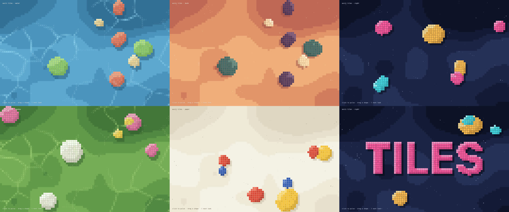
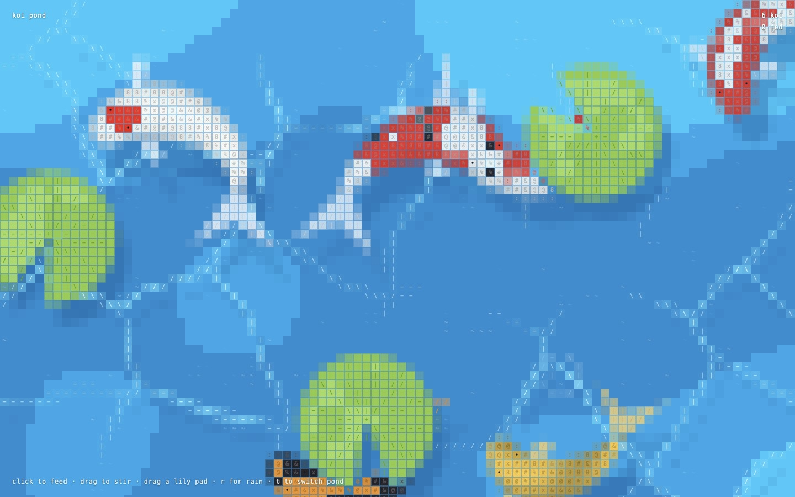
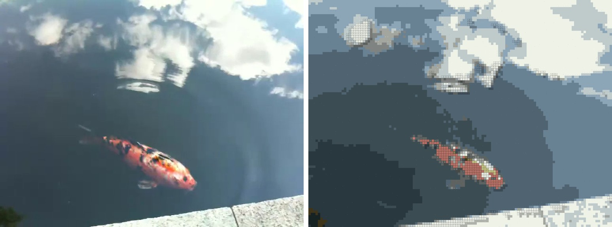

# ASCII tiles







The style is not about ponds. Anything with a clear subject on a calmer ground works: a product on a backdrop, a person against a wall, a word over a field, birds in a sky, a car on a road. The pond is just the worked example.

| path | what |
|---|---|
| `template/index.html` | The live scene to start from: the renderer, the compositing helpers, banded ground, light lines or flecks, draggable tiled shapes with shadows, click pulses, five looks (`?look=`, `l` cycles) and a word in tiles (`?text=`). Edit `LOOKS` and the `Thing` class |
| `examples/koi-pond/` | A full worked example: a koi pond and a green pond with creatures that steer, feed and school, plus a converted video. `t` cycles all three. See its README |
| `scripts/ascii_video.py` | Convert a video, GIF or still into the look. `uv run`, deps inline, `--help` lists every flag |
| `scripts/motion_check.py` | Frame-to-frame change of a clip (or source vs output): catches flicker and loop jumps |

## The look

Keep all of these. Each is part of why it reads as this style and not as a mosaic filter.

1. **One cell, one colour.** The grid is coarse (16 CSS px per cell on a laptop, about 90 columns). Every cell is a single flat colour, so curves become stair-steps. Do not smooth or anti-alias between cells.
2. **The background is bands, not gradients.** Three to five flat colours separated by thresholds on low-frequency noise (live) or by a fitted palette (footage). The bands drift slowly. Fine texture inside a band is noise, not information: leave it out.
3. **Tiles mark the subject.** A subject cell is a square inset by a thin gap (about 1/16 of the cell), so a body reads as a mosaic of tiles. The gap is the cell's own colour darkened (×0.7), never black. Background cells have no gap.
4. **Glyphs carry form, not tone.** Line glyphs `- \ | /` follow edges and light lines (pick by direction, see `lineGlyph`). Dense glyphs `# % & 8 @ x` fill bodies, fixed to the body so they turn with it rather than shimmer. Background gets sparse marks only: `* ' . ,` flecks, `~` glints.
5. **Glyph colour is the cell colour pushed toward contrast.** Darker on light cells, lighter on dark ones (about 30 to 60 percent). Never pure black or white glyphs.
6. **One drop shadow per tile body**, shifted by whole cells away from the light (1 to 2 cells), darkening the background cells it falls on. Shadows sit under the subject, never on top of it.
7. **Light crosses tiles as a tint, not a glyph.** Where a light line or ripple passes over a tile, lighten the tile and its glyph but keep the tile's own glyph, so bodies stay readable.
8. **Restraint.** About 10 subjects on a 90-column screen at most. If everything is a tile, nothing is.

## Route A: a live scene

1. Copy `template/index.html` into the project. Open it with a local server (`python3 -m http.server`); Playwright and some browsers block `file://`.
2. Pick the nearest look in `LOOKS` and set its colours: background bands dark to light, shadow (and `shadowAt`, which also sets where the light comes from), light and highlight, and the subject kinds. On a light ground (`paper`) the marks go darker, not lighter. `lines: true` gives drifting light lines (water caustics, sun through leaves); `false` gives twinkling flecks (stars, dust, sand).
3. Draw the real subject. Anything only has to answer "which cells do I cover" (a signed distance, an inside test, or an image mask) and then write tile colour (`tOver`), glyph (`gSet`) and shadow (`shadowB`):
   - Shapes: extend `Thing` (an ellipse here; swap in a capsule, a polygon, a sprite mask).
   - A word or logo: `?text=` draws it into a canvas at 4 px per cell and keeps cells over half covered. For a logo, `drawImage` the logo into that canvas instead of `fillText`. Cells shrink on narrow screens so each letter keeps about 6 cells.
   - Creatures: take the koi from the example (a follow-the-leader spine, tapered capsules, a forked tail, patterns from noise in body coordinates, steering with wander, avoidance and food).
   - A photo or product shot: run it through Route B as a still and use the result as a backdrop, or sample it per cell in `groundPass`.
4. Keep the render order in `render()`: shadows, light field, ground, subjects, light over subjects, pulses. Anything that tints tiles has to run after the tiles exist.
5. Check: `?seed=3&t=12` freezes a deterministic moment for screenshots, `?n=0` removes the shapes, `?cell=24` changes the grid. Measure fps over two seconds with `requestAnimationFrame`; the template and the pond hold 120 fps at 1440x900. Check a phone width too (390x844).

## Route B: convert footage

```sh
uv run scripts/ascii_video.py in.mp4 x.mp4 --preview 0,120,240 --preview-dir previews   # look first
uv run scripts/ascii_video.py in.mp4 out.mp4 --cell 8 --audio                            # then encode
uv run scripts/motion_check.py in.mp4 out.mp4                                            # then check
```

1. **Preview a few frames** across the clip before encoding, and compare them with the source.
2. **Pick the cell size** so the subject is at least 6 to 8 cells across: `--cell` is source pixels per cell, `--px` output pixels per cell (12 to 18).
3. **Tune by source type:**
   - Clean animation or flat illustration: defaults.
   - Real footage (people, products, animals, streets): defaults, `--crf 20` or so to keep files small. Busy texture everywhere (grass, leaves, crowds) turns into tiles everywhere; raise `--tile` or crop to the subject with a bigger `--cell`.
   - A still (product shot, portrait, poster): same flags; the output is one frame.
   - Dithered pixel art or dappled light: `--tile 24 --lw 0.3 --radius 7`. Otherwise the dither makes every cell stand out and the whole frame turns into tiles.
4. **Loops:** a looping GIF gets `--seamless --loops N`, which warms up the per-cell state so the seam does not jump. If `motion_check` shows a big last-to-first change in the source as well, the jump is in the source itself; say so rather than hiding it.
5. **Signatures:** if the source is signed, keep the signature with `--keep x,y,w,h` (source pixels). The grid would otherwise wash it out. Put any HUD text in another corner.
6. **Audio:** `--audio` keeps the source track, trimmed with `--ss`/`--t` like the video.

Showing a converted clip inside a live page: the example's `VIDEOS` entries play it fitted to the screen over a blurred copy of itself, with `space` to pause, `f` to fill and `m` for sound. Browsers may refuse sound after a reload, so start muted when `play()` is rejected and let `m` turn it on.

## Sources and credit

Converting someone else's video for your own use is fine. Anything published needs a source you may redistribute: your own footage, public domain, or CC licensed with credit in the page and the README. The example clip is CC BY 2.0 and credited on screen.

The cell-grid pond idea comes from the ASCII pond on daoho.dev. The code here is original.
