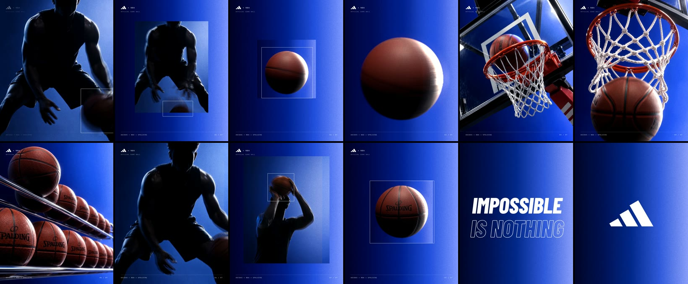

# photoreal-spot

A spot is one folder with a `spot.json`. Photoreal stills become short AI video clips; the
clips become frame sources; `tools/` turns the sources into plates (video segments and snap
cuts) on one global timeline; the fframes comp in `template/comp/` adds the finish (grade,
whips, kicks, flashes, HUD, tagline, end lockup, grain, vignette, soundtrack) and renders
the mp4. The cuts sit on the soundtrack's hits.



| path | what it is |
|---|---|
| `template/spot.json` | Starter spec: 15 s at 1080x1350, 30 fps, three sources (hero, detail, action), an opener and a collage of snap beats, three video segments, the comp finish and QA sections. |
| `template/tools/` | `new_spot.py` (folder layout), `study.py` (cuts and holds of a reference), `hits.py` (onsets, breakdowns, dips, fade of a soundtrack), `unpack.py` (clip to frame source), `plates.py` (video segments), `snaps.py` (snap beats, Jev tracking boxes), `assemble.py` (plates.mp4), `spot.sh` (all of it plus the render), `sheet.py` (contact sheets), `qa.py` (Jev QA against the reference), `spotlib.py` (shared). |
| `template/comp/` | The fframes crate. `src/spec.rs` reads spot.json, `src/lib.rs` draws the finish, `src/shaders/` holds grain, vignette and chromatic aberration (SkSL), `media/` the fonts (OFL, licences in `licenses/`). |
| `examples/adidas-nba/` | The worked example: its spot.json, the still prompts, the Vizard briefs, the start stills, and Jev QA reports for the final cut and for a rejected version. |
| `references/` | `look.md` (every measured number), `stills.md`, `video.md`, `snaps.md` (beat grammar and timing rules), `soundtrack.md`, `spot.md` (every key), `qa.md`, `case-study.md` (what went wrong on the example and how it was fixed). |

Requirements: Rust (cargo), `ffmpeg`, `uv`. Stills come from an image model (the `image`
skill on a ChatGPT login, or any photoreal model). Video comes from the Vizard CLI
(`vizard-editor` skill) or Wan (`wan-video` skill). Tracking boxes and QA need a TypeSafe key
in `$TYPESAFE_API_KEY` or the macOS keychain (service `TYPESAFE_API_KEY`); without one, skip
boxes and QA. The comp renders with Skia on Metal (macOS); for Linux switch `main.rs` to the
Vulkan context. Never print API keys.

## Workflow

Set `T=<this skill>/template`. Every tool takes the spot folder first.

### 1. Study the reference

```sh
uv run $T/tools/new_spot.py ~/spots/myspot          # folders + starter spot.json
cp ref.mp4 ~/spots/myspot/ref/ref.mp4
uv run $T/tools/study.py ~/spots/myspot/ref/ref.mp4 ~/spots/myspot/ref/study   # cuts.json, cuts.jpg
uv run $T/tools/hits.py ~/spots/myspot/ref/ref.mp4 --out ~/spots/myspot/ref/hits.json
```

Look at `cuts.jpg` and write down, per section, the editing device the reference uses: full
frames, inset cards, outline boxes (held or following the subject, single or trailing),
smears, black frames, whips, type. Note hold lengths from `cuts.json` and which hits the cuts
sit on. Then match the device, not an idea of it: if the reference cuts snap frames on the
hits, don't substitute a timer, a countdown or a different gimmick. `references/look.md` has
what was measured on the example's reference, and `references/snaps.md` the timing rules.

### 2. Plan the shots on the track

Put the soundtrack in `runtime/` (`track.wav`) and run `hits.py` on it if it is not the
reference's. Lay the shots out in `spot.json` (`shots`, global frames): main cuts on the
strongest onsets and on "the bass comes back" after a breakdown or dip, snap sections where
the track rolls. Write one line per shot: what is in it and what moves. See
`references/soundtrack.md`.

### 3. Photoreal stills

One still per video shot, as its start frame, made in the 4:5 frame you will use. Write one
shared look block (backdrop, lighting, style, avoid list) and add one `Primary request` per
shot; attach a real product photo as a look reference when the product must match. Read every
still: product shape and wordmark right, hands and anatomy right, nothing extra in frame.
`references/stills.md` has the prompt structure and the example's prompts.

### 4. AI video

Turn the stills into 5 s clips. With Vizard, always pass `-t flash` (the default tier costs
about 30x more) and confirm the credit spend with the user first; ask for each shot as its own
raw file. The brief says what each still is, the move, the camera, and what must not morph.
Check every clip on a contact sheet before using it, then unpack it:

```sh
uv run $T/tools/sheet.py raw/hero.mp4 0-120/8 out/hero_sheet.jpg
uv run $T/tools/unpack.py raw/hero.mp4 ~/spots/myspot hero      # frames/hero/0000.png...
```

Clips differ in fps and length (Vizard returned 30 fps / 150 frames and 24 fps / 121
frames in the example); `unpack.py` keeps every frame as delivered and prints the count.
`references/video.md` has the brief template, costs and failure checks.

### 5. Plates and snap cuts

Fill `sources`, `segments` (video shots) and `beats` (snap cuts) in `spot.json`.

- A segment plays a source from `start` at `step` source frames per output frame (1.5-2 reads
  as the slightly sped-up commercial pace), with a slow `zoom` and optional `roll`.
- A beat is `full`, `card`, `smear` or `black`, held for its `at` range, with optional
  `box` (around the subject, found by Jev) and `frame` (a fixed rectangle). A box on a moving
  subject needs `"track": true`, or it stays where the subject was on the beat's first frame;
  `"trail": 2` also draws the last two positions fainter.

```sh
uv run $T/tools/plates.py ~/spots/myspot
uv run $T/tools/snaps.py ~/spots/myspot            # or a range: snaps.py SPOT 0-46
uv run $T/tools/sheet.py ~/spots/myspot/renders/opener 0-44 out/opener.jpg --cols 9
```

Box answers are cached in `boxes.json` by frame content and prompt, so a rebuild with the
same beats makes no calls. `references/snaps.md` has the beat grammar and design rules.

### 6. Render

```sh
$T/tools/spot.sh ~/spots/myspot                     # plates, snaps, assemble, comp -> out/myspot.mp4
```

The `comp` section sets audio, kicks (the main cuts), whips, flashes, the HUD, the tagline
and the end lockup; logos and the soundtrack are files in `runtime/`. The first cargo build
takes a few minutes; a render of 15 s takes about 1.5 min. The size and fps are constants in
`comp/src/lib.rs` (`WIDTH`, `HEIGHT`, `FPS`; layout scales with width); the comp refuses a
spot.json that disagrees.

### 7. QA

```sh
uv run $T/tools/sheet.py out/myspot.mp4 0-449/6 out/sheet.jpg
uv run $T/tools/qa.py ~/spots/myspot out/myspot.mp4
```

Look at the contact sheet yourself first. `qa.py` asks Jev, per frame of ours and of the
reference, whether it is a framed snap cut, how real the subject looks, and any yes/no
questions you add (for example "is a countdown visible?"); per section it scores device match
and look match with the reference (0 different to 2 same). The reference's answers are the
control: a question that fires as often on the reference as on ours measures nothing. Fix the
weakest section and run it again. `references/qa.md` has the questions, controls and the
example's numbers.

## Rules

- Copy the reference's editing devices and pacing, not its frames. Stills, poses, layouts,
  type and the lockup are yours.
- Anything that should look real is generated as video from a photoreal still. Procedural CG
  (particle rain, simple 3D balls) scored clearly lower on realism in the example and read as
  CG to the user.
- Hold snap beats 2-4 frames in a roll and 6-9 on a main hit; cut on onsets.
- Boxes go on beats where the subject is clearly visible; a box on a frame-filling subject
  runs off the edges, so leave it off.
- Confirm before spending video credits; draft at the cheapest tier.
- Keep everything the user did not make or license out of anything published: the reference,
  its soundtrack, brand logos. Say so in the spot's README.

## Gotchas

- `snaps.py` and `plates.py` address a source by sorted file position, so 0-based unpacked
  frames and 1-based renders work the same; indices past the end clamp to the last frame.
- A cached box is keyed by a 96x120 thumbnail of the frame; change `start`, `step`, `zoom` or
  `card` and the beat makes new calls.
- `assemble.py` writes black where a frame has no render and lists those frames; a black run
  you did not plan means a beat or segment is missing.
- Changing `look.gradient` changes both the comp's backdrop and the cards' backdrop (snaps.py
  reads the same stops).
- The tagline and end card are `comp` shots; they must come after all plate shots and be
  contiguous.
