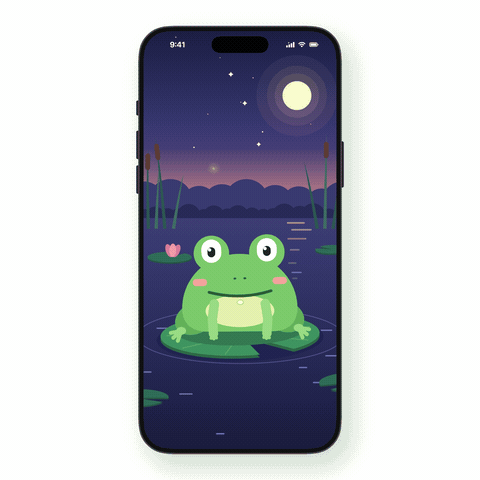

# Pond



An original example made with this skill's SwiftUI engine (`templates/swiftui/Motion.swift` and `LiveFace.swift`). The frog, the firefly and the pond are new art. They are not part of the upstream demos. One clock, a 10-second loop at 60 fps, in a phone frame. [MP4](pond.mp4)

## The story, beat by beat

| Time | What happens | Skill section |
|---|---|---|
| 0.0-1.5 s | Idle: breathing, a throat that keeps pumping, the pad bobbing and rocking, rings on the water, reeds swaying, stars and far fireflies blinking. The frog glances up at a far firefly as it flashes. | 1, 3, 4 |
| 1.7-3.5 s | The firefly enters from beyond the screen edge, already flying. The pupils find it first, the head turns 150 ms later, and the frog blinks on the turn. It crouches and narrows its eyes to aim. | 4, 5 (rule 13) |
| 3.5-3.9 s | The strike: the body stretches and leans in, the mouth opens, and the tongue shoots out with ease-out, holds 100 ms at full reach, and comes back. The firefly started rising before the tongue left, so the tongue only reaches where it was. | 5 (rules 8, 13) |
| 3.9-4.6 s | "Whoa": the frog recoils, the front legs fling out, a small "oh", and a double blink. | 5 |
| 4.6-6.4 s | The firefly lands on the nose. Each pupil aims from its own eye, so the eyes cross by themselves. A puzzled head tilt, a slow contented blink, two ribbits (the throat puffs), and a happy squint. The firefly's light falls on the face. | 4 |
| 6.4-7.4 s | It takes off. The frog crouches, hops (the legs hang and the shadow on the pad shrinks), lands with a squash that keeps the volume, and the pad dips while rings spread. | 5 (rules 8, 9, 11, 12) |
| 7.4-9.0 s | The frog leans and watches it leave past the left edge, then turns back to you with a blink. | 5 (rule 7) |
| 9.1-9.6 s | It licks its lips with a smug half squint. Everything settles into frame 0. | 6 |

## How it is built

- `Act` holds the key poses as data, one `flow` array per channel: squash, lean, head, both front legs, gaze and the firefly's path. Blinks, the cheek squint, the mouth and the ribbits are `track` keys, because each is one move.
- Every channel gets idle life on top (breathing, sway, head tilt), and follow-through by delay: the head counters the lean 110 ms late, the forearms trail the upper arms by 90 ms, and the head turn trails the gaze by 150 ms.
- Contact is solved through the frog's real transform: pad bob and rock, then the hop, then lean and squash around the feet, then the head tilt. The firefly on the nose, the tongue's target and the gaze all go through those transforms every frame, so nothing slides.
- Everything visible at the loop's seam runs on periods that divide 10 s (1250, 2500, 5000 and 10000 ms). The firefly's uneven wobble periods are fine because it is off screen at the seam. Frame 0 and the frame at 10 s differ less than two neighbouring frames do.
- Shapes that meet are drawn so no hairline shows: each lily pad and its notch is one outline. The firefly's light on the face is masked by the whole silhouette (body and eye bumps drawn separately into the mask), so it never stops at a seam.

## Render it

From the skill's folder, on macOS 14+ with `ffmpeg`:

```bash
swiftc -parse-as-library -target arm64-apple-macos14 \
  templates/swiftui/Motion.swift templates/swiftui/LiveFace.swift \
  demo/Color+Hex.swift demo/PhoneMockup.swift examples/pond/*.swift -o /tmp/render-pond
/tmp/render-pond /tmp/pond phone fps=60
ffmpeg -framerate 60 -i /tmp/pond/%04d.png -vf "scale=1080:1080:flags=lanczos,format=yuv420p" \
  -c:v libx264 -crf 20 examples/pond/pond.mp4
ffmpeg -framerate 60 -i /tmp/pond/%04d.png -vf "fps=20,scale=480:480:flags=lanczos,split[a][b];[a]palettegen=max_colors=160:stats_mode=diff[p];[b][p]paletteuse=dither=bayer:bayer_scale=3:diff_mode=rectangle" \
  examples/pond/pond.gif
```

Add frame numbers after `fps=60` to render only those frames, for example `0 213 330 412`. Leave out `phone` to get the bare 720 x 720 scene.

It reuses `Color+Hex.swift` and `PhoneMockup.swift` from `demo/`. It has its own `render.swift` because the demo renderer's `@main` only knows the four upstream scenes.
