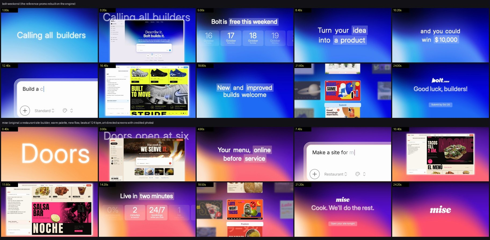

# saas-promo

A promo is one `video.toml` next to an `assets/` folder (screens, cards, a logo SVG, fonts)
and an `audio/` folder (the music). The engine in `template/` reads the spec, lays the scenes
out in seconds or beats, snaps the cuts to the music's beat grid, and draws every frame in a
1280x720 design space, output at 1920x1080, 30 fps. One build serves any number of films.

| path | what it is |
|---|---|
| `template/` | The fframes crate (`cargo build --release` once; the first build takes 1-2 min). `src/spec.rs` reads the spec, `src/kit.rs` holds the shared look (palette, the backdrop shader and its framings, glass type, highlight boxes, the 3D camera, cursor, letterbox), `src/scenes/` has one file per kind, `src/shaders/` the backdrop and halftone shaders, `media/` the Inter and Anton fonts. |
| `template/tools/` | `promo.sh` (run the engine on a spec), `beats.py` (beat grid of a track → `build/beats.json`, snapped cut list), `bgm.py` (an original synthesized bed cut to the spec), `palette.py` (a full `[palette]` from one brand colour), `screens/render.py` (HTML mock-ups → PNG, layer by layer), `images/fetch.py` (credited photos from Openverse or Bing, with a contact sheet to vet), `images/cutout.py` (cut a subject off its background), `bgfit/fit.py` (fit a backdrop framing to any reference frame), `cmp.sh` (reference vs ours at the same seconds), `sheet.py`, `refsheet.py` (contact sheets). |
| `template/examples/bolt-weekend/` | The worked example: bolt.new's 27.7 s "Bolt is free this weekend" promo rebuilt on the generic kinds, scene starts on the original cuts. `reference.jpg` = frames from the original, `render.jpg` = ours at the same times. It plays over an original synthesized track (`tools/bgm.py`); the promo's own video and music aren't included. |
| `template/examples/mise/` | An original film for a fictional AI site builder for restaurants: warm palette, a different flow, durations in beats at 124 bpm, an original synthesized track, and art-directed screens (HTML in `screens/`, real credited photography and cut-outs). It shows what changes between films. |
| `references/` | `screens.md` (art direction for the screens, the slop checklist, recipes), `spec.md` (every `video.toml` key, timing model, backdrop presets, music), `kinds/*.md` (every kind's params, defaults and measured timing), `look.md` (what makes the style and every measured number), `case-study.md` (how the reference was rebuilt, lessons). |

Requirements: Rust (cargo), `ffmpeg`, `uv`. Screens render with Playwright's Chromium
(`uvx playwright install chromium` once). The engine renders with Skia on Metal (macOS);
for Linux, switch `main.rs` to the Vulkan context (see the fframes docs).

## Workflow

Read `references/look.md` first: the style is a small set of moves (glass words, popping
highlights, a camera that always settles, blur cuts, one gradient world) and they matter more
than any single scene.

1. **Copy an example** to `template/examples/<name>/` (`mise` is the cleaner starting
   point). Write the story as 8-12 beats: hook (title), what it is (window), the offer
   (tiles/caption), how it works (prompt → screen), proof or community (wall), CTA (end).
   Captions are 2-6 words a line, two lines, one or two `[highlight]` runs on the payoff.
2. **Screens: art direction, not UI filler.** Read `references/screens.md`. The screens
   carry the taste: pick a product whose output is visual, give each screen one big idea (a
   giant outlined word behind a cut-out, a colour-block page, a collage), use real photos
   with credits (`uv run tools/images/fetch.py screens/img tacos "tacos"`, then look at the
   contact sheet and cut subjects out with `tools/images/cutout.py`), make every wall card a
   different business, write specific copy. Reject anything on the slop checklist (purple
   gradient heroes, skeleton bars, identical rounded cards with pastel icon squares).
   Make each UI a small HTML page in `screens/`, then render: `uv run
   tools/screens/render.py screens/window.html "assets/window_{layer}.png" --select "#win"
   --layers side,hero,nav,h1,h2,...` (elements with `data-layer` render one at a time,
   transparent: keep the window's own background off the root element or every layer covers
   the one below). Tall pages for `screen` use `--full` or `--select "#doc"`.
3. **Colour.** `[palette] preset = "blue" | "ember" | "mint" | "violet" | "noir"`, or
   `uv run tools/palette.py "#ff5a1f"` and paste the block. `[look] font` takes any face
   whose TTF you drop in `assets/`.
4. **Music and progression.** Bring a track (`audio/bgm.mp3`; fframes reads wav, mp3, flac,
   ogg, not m4a) and run `uv run tools/beats.py audio/bgm.mp3 --spec video.toml`: it writes
   the beat grid the engine snaps cuts to and prints each scene's start before/after
   snapping. Or set `bpm` and give scenes `beats = n`. No track? `uv run tools/bgm.py
   video.toml --bpm 124` synthesizes an original bed with whooshes on the cuts, risers into
   `drop = true` scenes and an impact on the end card.
5. **Render and look.** `tools/promo.sh examples/<name>/video.toml render -o out.mp4`
   (about 1 s of render per second of film). Then `uv run tools/sheet.py out.mp4 sheet.png
   --fps 4` and read every tile: unreadable UI, a highlight on the wrong word, a layer
   covering another, dead holds. `frame 4.2s,7s -o frames` for single frames, `inspect` for
   missing fonts or images (it also lists text cut by the frame edge: intended during the
   prompt push-in and the tile slide).
6. **Rebuilding a reference instead?** Measure it (cuts, word timings, camera) and compare
   with `REF=original.mp4 tools/cmp.sh video.toml cmp.png 2.0 4.5 7.25`; fit its backdrop
   with `tools/bgfit/fit.py`. `references/case-study.md` is how the example was done.

## Scene kinds

| kind | what | doc |
|---|---|---|
| `title` | huge glowing glass words arrive one by one while the camera pulls back; optional halftone ring + frosted pill that hand over to a window | `kinds/title.md` |
| `window` | the pill grows into an app window that builds up layer by layer (`layers = [{ image, at, ... }]`), the title stays behind as outlined glass | `kinds/window.md` |
| `tiles` | a headline with a highlight over a row of frosted tiles that slides so the `on` tiles land centred and light up (`tiles = [...]` or `dates = { from, to, on }`) | `kinds/tiles.md` |
| `caption` | 1-3 lines of glass words with `[highlight]` runs; five measured moves (`settle`, `push`, `drop`, `glide`, `lift`) and exits (`move`, `drift`, `blur`, `cut`) | `kinds/caption.md` |
| `prompt` | a prompt box blurs in, the camera pushes in, the text is typed with a caret and followed, pull back, the cursor clicks send | `kinds/prompt.md` |
| `screen` | an app window swings in from blur; its content image scrolls inside a viewport; optional streamed text, overlays and a sprite flipbook | `kinds/screen.md` |
| `wall` | a card wall with depth of field and slide-ins; the centre card swaps through colour-band wipes (images, a springing word, or a built-in poster); a button is clicked; letterbox | `kinds/wall.md` |
| `end` | the logo (an SVG, written on path by path, or `logo_text`) with a glass tagline and a CTA pill; they blur away and the logo grows | `kinds/end.md` |

Every scene also takes `dur` or `beats`, `at`, `bg` (backdrop framing presets, or a list to
drift through), `bg_zoom`, `dots`, `letterbox` and `drop` (`references/spec.md`).

## Making it yours, not a re-skin

- Keep the moves (glass entrances, popping highlights, settling camera, blur cuts), change
  the story, copy, screens, palette and order. The example's order is one good arc, not a
  template to fill.
- Captions: the payoff in the highlight, never the whole line. Hold 1.3-1.8 s; under 1 s
  reads as a flash, over 2.2 s as a slide.
- UI: real-looking, specific content (names, numbers, a believable prompt). Push in on the
  one thing that matters; nobody reads a whole window in 2 s.
- Cut on the music: put the title, the main reveal and the logo on the strongest hits
  (`drops` from `beats.py`).
- `[look] pace = 0.85` tightens every entrance/exit without touching durations; longer `dur`
  only lengthens holds.

## Gotchas

- `svgr!` drops a numeric `font-weight={u16}` and renders 400; pass a string (kit does).
- Assets are flat: `assets/window_hero.png`, not `assets/window/hero.png` (the loader isn't
  recursive). Fonts in `assets/` register by family name.
- `center`, `layers` and `content_layers` take image names or tables
  (`{ image = "a.png", at = 0.4 }`).
- `.m4a` music fails (`CanNotProcessAudioDuration`); convert to mp3 or wav.
- Backdrop framings behind full-frame windows or card walls can't be fitted from the
  reference (too little gradient visible); borrow a neighbouring preset.

## Credits and licences

The engine is original code on [fframes](https://github.com/dmtrKovalenko/fframes) (MIT).
Fonts: Inter and Anton (SIL OFL 1.1, `template/licenses/`). The look and timings were
measured on bolt.new's "Bolt is free for everyone, all weekend long" promo (StackBlitz);
`examples/bolt-weekend/reference.jpg` shows frames from it for comparison, and the
example's sources (the bolt.new wordmark, product photos and clip art inside the rebuilt
screens) are listed in `examples/bolt-weekend/SOURCES.md`. The `mise` example's design, copy and music are original; its photos are credited in `examples/mise/SOURCES.md`. Its
screens and its music are original.
